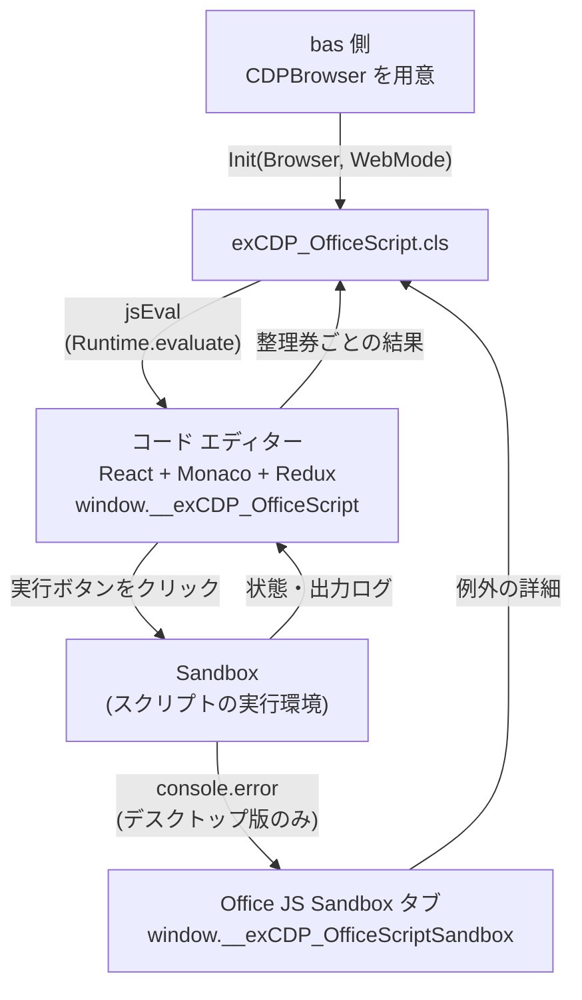

# OfficeScriptViaVBA

VBA から CDP 経由で Excel の「コード エディター」(Officeスクリプト) を操作する拡張です。\
VBA で用意したスクリプトをエディターに書き込んで実行し、結果、console.log の出力、例外の詳細を VBA 側で受け取ります。\
デスクトップ版 Excel と、Edge で開いた Web 版 Excel の両方に対応しています。

> [!WARNING]
> **POC から生まれた実装です。** コード エディターの内部構造 (React / Redux) を直接読み書きしているため、Office 側の更新で動かなくなる可能性があります。

> [!TIP]
> Web 版 Excel のシートは Canvas で描画されるため、画面の DOM からはセルの値を扱いにくくなっています。\
> Officeスクリプト経由なら、Canvas を通さずにセルの値を読み書きできます。

***

## ファイル構成

```
OfficeScriptViaVBA/
├── ReadMe.md
├── OfficialRoute/                       ← エディターに書き込んで「実行」ボタンで動かす (Officeスクリプトとしての正規の流れ)
│   ├── exCDP_OfficeScript.cls           ← Officeスクリプトの書き込み・実行・結果回収を行う拡張クラス
│   ├── Demo_OfficeScript.bas            ← CDPBrowser の用意 (デスクトップ版 / Web版) と、Demo 01〜05
│   ├── Demo_OfficeScript_Showcase.bas   ← 録画向けのショーケース (描画 3本・読み取り 2本)
│   └── Demo_OfficeScript_ShowcaseLoop.bas ← 描画系を「スクリプト1本の中でループ」させる版
└── DirectRoute/                         ← コードエディターのページの Office.js (Excel.run) を直接呼ぶ
    ├── exCDP_OfficeJs.cls               ← Office.js ダイレクト実行の拡張クラス
    ├── Demo_OfficeJs_Showcase.bas       ← ショーケースの Office.js ダイレクト版 (リメイク版)
    └── Demo_OfficeJs_ShowcaseLoop.bas   ← 描画系を「Excel.run 1回の中でループ」させる版
```

***

## 動作条件

| 項目 | デスクトップ版 Excel | Web 版 Excel |
| --- | --- | --- |
| 接続先 | Office アドインの WebView2 | Excel を開いている Edge |
| ユーザーデータフォルダ | `%LOCALAPPDATA%\Microsoft\Office\16.0\Wef\webview2\2\1\EBWebView` | `%LOCALAPPDATA%\Microsoft\Edge\User Data` |
| 事前準備 | [自動化] タブからスクリプトを開き、コード エディターを表示しておく | Edge のリモートデバッグを有効にし (`edge://inspect/#remote-debugging` で許可など)、Web 版 Excel でコード エディターを表示しておく |
| コード エディターの場所 | タブ (タイトル「コード エディター」) | Excel ページ内の iframe (URL に `index.html#/edit` を含む) |
| 例外の詳細 | 「Office JS Sandbox」タブから回収 (name / message / stack) | エディターの出力ログから回収 (message のみ) |

どちらの場合も、外部ドライバや追加のインストールは不要です。

***

## 使い方

### 1. CDPBrowser を用意する (bas 側)

接続と切断は bas 側で行います。`Demo_OfficeScript.bas` の `ConnectDesktopExcel` と `ConnectWebExcel` が、そのまま使える実装例です。

```vba
'デスクトップ版 Excel (Office アドインの WebView2) へ接続する例
Dim UserDataDir As String
UserDataDir = Environ("LOCALAPPDATA") & "\Microsoft\Office\16.0\Wef\webview2\2\1\EBWebView"

BrowserCapabilities.Set_UserDataDirName = UserDataDir
Dim WebSocketCDP As CDPCoreViaWebSocket: Set WebSocketCDP = New CDPCoreViaWebSocket
WebSocketCDP.EnsureWebView2DebugPort = 0                 'Web 版ではこの行は不要
If Not WebSocketCDP.AutoConnectDevToolsActivePort(BrowserCapabilities) Then Exit Sub

ReattachOptions.Set_WebSocketMode(WebSocketCDP) = UserDataDir
Dim Browser As New CDPBrowser
Browser.reattach ReattachOptions
```

Web 版の場合は、`UserDataDir` を Edge のユーザーデータフォルダにして、`EnsureWebView2DebugPort` の行を外します。

### 2. Init でコード エディターを確保する

```vba
Dim os As New exCDP_OfficeScript
If Not os.Init(Browser) Then Exit Sub                    'デスクトップ版
'If Not os.Init(Browser, WebMode:=True) Then Exit Sub    'Web 版
```

英語 UI などでタイトルや URL が異なる場合は、第3引数 `EditorKey` で探し方を指定します (デスクトップ版はタブのタイトル、Web 版は iframe の URL。どちらも部分一致)。

### 3. 同期実行

```vba
Dim Script As String
Script = "function main(workbook: ExcelScript.Workbook) {" & vbLf & _
         "    workbook.getActiveWorksheet().getRange(""A1"").setValue(""Hello"");" & vbLf & _
         "    console.log(""done"");" & vbLf & _
         "}"

Debug.Print os.RunScript(Script)     '→ Succeeded / Failed / Timeout など
Debug.Print os.LastLogs              '状態の遷移、出力ログ、メッセージバーの内容
```

### 4. 非同期実行 (整理券方式)

`RunScriptAsync` は実行を開始した時点で整理券番号を返します。結果は、整理券番号を渡して後から受け取ります。

```vba
Dim Ticket As Long
Ticket = os.RunScriptAsync(Script)
If Ticket = 0 Then Debug.Print "開始できませんでした: " & os.LastLogs: Exit Sub

'(VBA 側で別の作業)

Debug.Print os.WaitResult(Ticket, 60)            '完了まで待つ
'または、待たずに1回だけ確認する
'If os.TryGetResult(Ticket, Status) Then Debug.Print Status
```

`Application.OnTime` で結果を回収する場合は、`exCDP_OfficeScript` と `CDPBrowser` の両方をモジュールレベル変数で保持します (Demo 02 を参照)。

> [!IMPORTANT]
> **デスクトップ版で、ブックの読み取りが多いスクリプトは、OnTime で回収してください。** デスクトップ版の Officeスクリプトは Excel と同じプロセスで動きます。そのため、`RunScript` や `WaitResult` で VBA が待っている間は、スクリプトのブックへの問い合わせが進まないことがあります。\
> 実際に、全シートを読み取る `Showcase_04_ブック棚卸し` では、手動で実行すると数十秒で終わるのに、VBA から同期で待つと結果が返らずにタイムアウトし、マクロが終わった直後に結果が届きました。\
> `RunScriptAsync` で実行を始めたらマクロをいったん終え、`Application.OnTime` で `TryGetResult` を定期的に呼ぶ形にすると、最後まで実行できます (`Showcase_04_Poll` を参照)。Web 版ではこの問題は起きませんでした。

### 5. 結果と例外の確認

```vba
Dim Line As Variant
For Each Line In os.LastOutputs                  'console.log などの出力を1件ずつ
    Debug.Print Line
Next

If Not os.LastExceptionDetails Is Nothing Then
    Debug.Print os.LastExceptionMessage                      'intentional error from VBA
    Debug.Print os.LastExceptionDetails.StringKey("stack")   'デスクトップ版のみ
End If
```

`LastExceptionDetails` は `BiDiCDPJConv` で、中身は次の形です。例外が無いときは Nothing を返します。

```json
{"time": 1793861079819, "name": "Error", "message": "intentional error from VBA", "stack": "Error: ...", "raw": "Command Error:\n..."}
```

### 6. 後片付け

`os.Dispose` でコード エディターへの参照を手放してから、bas 側で切断します。

```vba
os.Dispose
Browser.DisconnectCDP
```

**この順番は守る必要があります。** `CDPContext` は破棄されるときに `Target.detachFromTarget` などを送るため、先に切断すると、閉じたソケットへの送信になり WinSock のエラー 10038 が出ます。\
`DisconnectCDP` は CDP の接続を閉じるだけで、Excel や Edge は閉じません。

***

## API 一覧

| メンバー | 種類 | 内容 |
| --- | --- | --- |
| `Init(Inheritance, [WebMode], [EditorKey])` | Function | 接続済みの `CDPBrowser` を受け取り、コード エディターを確保します。確保できれば True |
| `Dispose` | Sub | コード エディターと Sandbox への参照を手放します。`CDPBrowser` は切断しません |
| `IsConnected` | Property | `Init` 済みかどうか |
| `IsWeb` | Property | Web 版として `Init` したかどうか |
| `RunScript(Raw, [TimeoutSec=120])` | Function | 書き込んで実行し、完了まで待って状態を返します |
| `RunScriptAsync(Raw)` | Function | 書き込んで実行を開始し、整理券番号を返します。開始できなければ 0 |
| `TryGetResult(TicketID, [Status])` | Function | 1回だけ確認します。完了していれば True |
| `WaitResult(TicketID, [TimeoutSec=120])` | Function | 完了まで待って状態を返します |
| `IsRunning` | Property | スクリプトの実行中かどうか (VBA 以外から実行したものも含む) |
| `LastTicket` / `LastStatus` | Property | 直近に回収した整理券番号と状態 |
| `LastLogs` | Property | 直近のログ全文 |
| `LastOutputs` | Property | 直近の出力ログを1件ずつ格納した Collection |
| `LastExceptionDetails` | Property | 直近の例外の詳細 (`BiDiCDPJConv`)。無ければ Nothing |
| `LastExceptionMessage` | Property | 直近の例外のメッセージ。無ければ空文字 |

### 状態の値

| 値 | 意味 |
| --- | --- |
| `Succeeded` | 正常に終了した |
| `Failed` | スクリプト内でエラーが発生した |
| `Unsupported` | コード エディターの `runningStatus` が `Unsupported` で終わった |
| `Timeout` | 待機時間内に終わらなかった。スクリプト自体は続いているため、同じ整理券番号で待ち直せる |
| `NotStarted` | 開始できなかった (`Init` 前、別のスクリプトが実行中、書き込みが store に反映されなかった等)。理由は `LastLogs` |
| `Error` | 結果を取得できなかった (ページの再読み込みで結果が失われた等) |

### LastLogs の行の種類

| 接頭辞 | 内容 |
| --- | --- |
| `ticket:` / `history:` | 整理券番号、最終状態、状態の遷移 (例: `InProgress -> Succeeded`) |
| `[output]` | エディターの出力ログ (console.log、エラーメッセージ) |
| `[problem]` | エディターの問題ログ |
| `[messageBar]` | 「スクリプトを実行中...」などの通知 |
| `[exception]` | 回収した例外 (`name: message`) |

***

## 技術的な仕組み

### 全体の流れ



### 接続

| | デスクトップ版 | Web 版 |
| --- | --- | --- |
| デバッグポート | `EnsureWebView2DebugPort` が環境変数 `WEBVIEW2_ADDITIONAL_BROWSER_ARGUMENTS` を設定し、Office 側の WebView2 のポートを開けます | Edge 側でリモートデバッグを有効にします |
| 接続方法 | ユーザーデータフォルダの `DevToolsActivePort` に書かれたブラウザ用 WebSocket へ接続します (`AutoConnectDevToolsActivePort`) | 同左 |
| エディターの確保 | `getTab("コード エディター")` | `getTab(Url:="index.html#/edit", SearchTypeID:=kFrame)` |

デスクトップ版の環境変数は、WebView2 が起動する前に設定されている必要があります。接続できない場合は、一度実行した後にコード エディターを開き直してください。

`edge://inspect` でリモートデバッグを許可した Edge は、`/json` などの HTTP エンドポイントが 404 を返します。`DevToolsActivePort` に書かれたブラウザ用 WebSocket には接続できるため、Web 版もデスクトップ版と同じ方法で接続しています。

Web 版のコード エディターは、デスクトップ版と同じアプリ (同じ React / Redux 構成) です。Excel のページ内に、別プロセスの iframe として置かれています。そのため、iframe を `kFrame` で探して確保すれば、以降の処理は共通です。

### Monaco Editor と Officeスクリプトの関係

Officeスクリプトのコード エディターは、Microsoft がオープンソースで公開しているエディター部品「Monaco Editor」を使っています。Monaco Editor は Visual Studio Code のエディター部分を切り出したもので、Web ページに組み込んで使えます。コード エディターの DOM には `.monaco-editor` の要素があり、Web 版の CDP のターゲット一覧にも、Monaco が使う `editorWorkerService` と `typescript` の Worker が並んでいました。

Officeスクリプトのアプリは、この Monaco Editor を React の部品として組み込み、実行ボタン、出力ログ、スクリプトの保存などを独自に作っています。そのため、この拡張が頼っている部分は、仕様が公開されている部分と、Office 独自の部分に分かれます。

| 部分 | 出どころ | この拡張での扱い |
| --- | --- | --- |
| エディターの編集操作 (`getModel` / `executeEdits` / `pushUndoStop` / `getFullModelRange`) | Monaco Editor の公開 API | 公開 API をそのまま使って全文を置き換えます。エディターのインスタンスかどうかも、`getModel` と `executeEdits` を持っているかで判断します |
| React の内部情報 (`__reactFiber$...`) と react-redux の `Provider` | React / Redux (オープンソース) | よく知られた調べ方で、エディターのインスタンスと store をたどります |
| エディターのインスタンスの置き場所 | Office 独自 | `window.monaco` が公開されていないため、React の内部情報からさかのぼって探します |
| Redux の state の形 (`run.runningStatus` など) | Office 独自 | ドキュメントは無く、実際の store を読み、実行前後の変化を見て特定しました |
| 実行ボタン、メッセージバーの表示タイミング | Office 独自 | 動かしたログをもとに、結果を確定する条件 (200ミリ秒と3秒) を決めました |
| Sandbox と例外の出し方 (`Command Error:`) | Office 独自 | 実際の出力を見て、フックの掛け方と分解の方法を決めました |

エディターへの書き込みは、Monaco Editor の公開 API の範囲で行っています。一方、Office 独自の部分にはドキュメントが無く、Office の更新で変わる可能性があります。「既知の制約」に書いた、Office 側の更新で動かなくなる可能性は、主にこの Office 独自の部分への依存によるものです。

### コード エディターの掴み方

コード エディターは、React で作られたアプリです。エディター部分には Monaco Editor、状態管理には Redux が使われています。`Init` のときに、ページ内へヘルパー `window.__exCDP_OfficeScript` を注入し、次の2つを掴みます。

- **Monaco Editor のインスタンス**: `window.monaco` として公開されていないため、DOM の `.monaco-editor` から React の内部情報 (`__reactFiber$...`) をさかのぼり、`stateNode.editor` を探します。
- **Redux の store**: react-redux の `Provider` に渡されている `memoizedProps.store` を探します。

store からは、次の状態を読みます。

| state のパス | 内容 |
| --- | --- |
| `run.runningStatus` | `None` → `InProgress` → `Succeeded` / `Failed` / `Unsupported` |
| `bottomPanel.outputLogs` | 出力ログ。`{id, message, severity}` の配列 |
| `bottomPanel.problemsLogs` | 問題ログ |
| `messageBar` | 画面上部の通知 (`isVisible`, `text`) |
| `editor.active` | 開いているスクリプトの ID |
| `scripts.scripts[id]` / `scripts.mruScripts` | スクリプトの本文 (`localUpdates.body` / `storageScript.body`) |

ヘルパーにはバージョン番号を持たせています。ページに古いバージョンが残っていた場合は、store の購読を解除してから入れ替えます。

### 書き込みと実行

1. **書き込み**: Monaco の `executeEdits` で全文を置き換えます。前後に `pushUndoStop` を入れているため、エディター上で Ctrl+Z で元に戻せます。
2. **反映待ち**: エディターの変更は、React の onChange を経由して Redux の store に反映されます。store 上の本文が書き込んだ内容と一致するまで待ちます (上限10秒)。
3. **実行**: ツールバーの「実行」ボタン (`aria-label` が「実行」または「Run」) をクリックします。実行されるのは、エディター上の未保存の内容です。

Officeスクリプトは、エディターに書き込んだ内容を自動で保存します。そのため、開いていたスクリプトの中身は上書きされます。

### 整理券と結果の確定

`run()` は、store を購読してから実行ボタンをクリックし、整理券番号を返します。購読中は、`runningStatus` の遷移とメッセージバーの表示をページ側で記録します。VBA 側は整理券番号で問い合わせるだけなので、好きなタイミングで結果を取りに行けます。

`runningStatus` が終了の状態になっても、結果のメッセージバー (「スクリプトが正常に実行されました。」など) は少し遅れて表示されます。そのため、次のどちらかを満たした時点で結果を確定します。

- 「実行中」と「結果」の2件のメッセージがそろい、最後の表示から200ミリ秒経った
- 終了から3秒経った

確定した時点で、その実行で増えた出力ログを保存し、store の購読を解除します。

実行中に別のスクリプトを書き込むと、実行中のスクリプトとエディターの内容がずれます。そのため、実行中の `RunScriptAsync` は 0 を返して開始しません。ボタンをクリックした直後で、まだ store に `InProgress` が反映されていない間 (5秒まで) も実行中として扱います。

### 例外の詳細の回収 (デスクトップ版)

スクリプト本体は、別のタブ「Office JS Sandbox」で実行されます。例外の詳細は、このタブの `console.error` にだけ、次の形式で出力されます。エディターの出力ログには「予期しないエラーが発生しました。」という汎用のメッセージしか届きません。

```
Command Error:
{"message":"...","name":"Error","stack":"Error: ...\n    at main (...)"}
```

Sandbox 側のコードは、`console.error` を呼ぶたびに参照し直しています。そのため、`Init` のときに Sandbox タブの `console.error` を差し替える (フックを掛ける) だけで例外を受け取れます。CDP のイベントを購読する必要はありません。

フック `window.__exCDP_OfficeScriptSandbox` は、受け取った出力を `{time, name, message, stack, raw}` に分解して、直近100件を保持します。元の `console.error` もそのまま呼ぶため、Office 側の動作は変わりません。

実行ごとの切り分けには時刻を使います。整理券ごとに実行開始の時刻を記録しておき、それ以降に出た例外だけを集めます。エディターと Sandbox は同じ PC の時計を使うため、そのまま比較できます。1回の実行で複数の例外を受け取った場合は、最初の `Command Error` を `LastExceptionDetails` に入れ、全件を `LastLogs` に `[exception]` 行として追記します。

stack の行番号 (`<anonymous>:213:11` など) は、Office 側でスクリプトを包んだ後のコードでの行番号です。書いたスクリプトの行番号とは一致しません。

### Sandbox のコンソール履歴の破棄 (デスクトップ版)

Sandbox タブは Excel を閉じるまで残り、実行のたびにコンソールの出力がたまっていきます。`CDPContext` は接続時に `Runtime.enable` を送るため、たまった出力が `Runtime.consoleAPICalled` としてまとめて送られてきます。履歴が約900KB (536件) たまった状態では、`Init` に16〜22秒かかっていました。

これを防ぐため、Sandbox に接続した直後と `Dispose` のときに `Runtime.discardConsoleEntries` を送り、履歴を捨てています。例外はフック側で別に保持しているため、回収には影響しません。履歴を捨てるようにしてからは、`Init` は約2秒で終わっています。

### 例外の詳細の回収 (Web 版)

Web 版では、Sandbox が `about:srcdoc` の iframe と、その中の Web Worker として作られます。どちらも実行のたびに作り直されるため、フックを掛けておけません。

一方で、Web 版のエディターの出力ログには、例外のメッセージがそのまま `severity: "error"` で届きます。そのため、Web 版ではこの出力ログから例外を回収します。stack は取れないため、`LastExceptionDetails` の `name` と `stack` は空文字です。

***

## Office.js ダイレクト版 (exCDP_OfficeJs)

コードエディターのページには、Office.js (`Office` / `Excel` / `OfficeExtension`) が読み込まれていて、Excel 本体とつながっています。`exCDP_OfficeJs` は、そのページで `Excel.run` を直接呼びます。エディターに書き込んで実行ボタンを押す `exCDP_OfficeScript` とは、次の点が違います。

| | exCDP_OfficeScript | exCDP_OfficeJs |
| --- | --- | --- |
| 動かし方 | エディターに書き込み、実行ボタンをクリック | ページの Office.js で `Excel.run` を直接呼ぶ |
| 書くコード | Officeスクリプト (ExcelScript。同期的に書ける) | Office.js (Excel JavaScript API。`load` と `await context.sync()` が要る) |
| 1回あたりの時間 | Web 版 約1.5秒、デスクトップ版 約4〜5秒 | 数百ミリ秒以下 (棚卸しは Web 版 約0.6秒、デスクトップ版 約0.08秒) |
| デスクトップ版で VBA が同期で待つとき | 読み取りの多いスクリプトが進まないことがある | 止まらない |
| エディターの中身 | 書き換わる (自動保存される) | 書き換えない |
| 例外の詳細 | デスクトップ版は Sandbox のフックから | Office.js のエラー (code と debugInfo) が `LastError` に入る |
| Microsoft が公開している使い方か | Officeスクリプトとしての正規の流れ | 違う。エディターのページの Office.js を借りている |

```vba
Dim ojs As New exCDP_OfficeJs
If ojs.Init(Browser, WebMode:=False) Then    'Web 版は WebMode:=True
    If ojs.Run("const r = context.workbook.getSelectedRange(); r.load('address'); await context.sync(); return r.address;") Then
        Debug.Print ojs.LastResult             '選択範囲のアドレス
    Else
        Debug.Print ojs.LastError              '"NG: ItemNotFound {...debugInfo...}" など
    End If
End If
ojs.Dispose
Browser.DisconnectCDP
```

`Run` には、`Excel.run(async (context) => { ... })` の中身を渡します。return した値は、文字列ならそのまま、それ以外は JSON 文字列にして `LastResult` に入ります。JavaScript 側で `TimeoutSec` (既定60秒) を過ぎると、`"NG: timeout"` で打ち切ります。

デスクトップ版では、コードエディターのほかに「Office JS Sandbox」「Excel Copilot Chat Add-in」「操作レコーダー」のタブでも `Excel.run` が通ることを確認しています (`Init` の `TargetKey` でタブのタイトルを指定できます)。Web 版では、コードエディターの iframe と Copilot アドインの iframe で通ることを確認しています。

### 演出：実行するコードをエディターにも表示する

ダイレクト版は実行場所がエディターではないため、そのままではエディターの画面が何も変わりません。録画などの見た目のために、`ShowInEditor = True` にすると、`Run` のたびに実行するコードをエディターに表示します。

```vba
ojs.ShowInEditor = True
ojs.EditorCaption = "Mandelbrot frame 5/120"     '表示の3行目に入る見出し
ojs.Run Body                                     '表示してから、Office.js で実行する
```

- 表示は結果を待たない CDP (`jsEval` の `RunAsyncCDP:=True`) で送るため、`Run` の速さはほぼ変わりません。実際の実行は、これまでどおり Office.js で行います。
- エディターの中身は表示用のコードで上書きされ、Officeスクリプトとして自動保存されます。
- 表示するのは Office.js のコードなので、Officeスクリプトのルール (引数の型など) に合わず、エディターの「問題」に警告が出ます。実行には影響しません。
- `Demo_OfficeJs_Showcase.bas` では、`SHOW_IN_EDITOR` (既定 True) で切り替えられます。見出しには、`[Showcase]` のログと同じラベル (例: `Mandelbrot frame 5/120`) が入ります。

## 既知の制約

- **同時に実行できるのは1本だけです。** コード エディターは1つしかないためです。
- **`main` に workbook 以外の引数を持つスクリプトは対象外です。** パラメーターの入力ダイアログが表示されるためです。
- **デスクトップ版では、VBA が同期で待っている間、読み取りの多いスクリプトが進まないことがあります。** Officeスクリプトが Excel と同じプロセスで動くためです。`RunScriptAsync` と `Application.OnTime` で回収してください (「4. 非同期実行」を参照)。
- **デスクトップ版では、Excel を起動して最初の実行の例外は取れません。** 「Office JS Sandbox」タブは、最初の実行が始まったときに作られます。それより前に `Init` したインスタンスは Sandbox に接続できず、`LastExceptionDetails` は Nothing になります。Failed の判定と、エディター側の出力ログには影響しません。1回実行した後に `Init` し直せば取れるようになります。確実に取るには、Sandbox が作られた時点での自動アタッチ (`Target.setAutoAttach` など) が必要ですが、設計が固まるまで保留しています。
- **Web 版で Excel を複数開いている場合は、最初に見つかったコード エディターを確保します。**
- **Office 側の更新で動かなくなる可能性があります。** React の内部情報、Redux の state の構造、実行ボタンの `aria-label`、Sandbox の `console.error` の形式に依存しているためです。

***

## デモ一覧

`Demo_OfficeScript.bas` に含まれるデモです。デモのスクリプトはアクティブシートの A1 / A2 を書き換えるため、空のシートで試してください。

| デモ | 内容 |
| --- | --- |
| `Demo_OfficeScript_01_同期実行` | デスクトップ版で、書き込み、実行、完了待ちまでを行います |
| `Demo_OfficeScript_02_非同期実行` | 実行を開始したらマクロを終え、`Application.OnTime` で結果を回収します |
| `Demo_OfficeScript_03_整理券で待つ` | 実行中の `IsRunning` と、2本目が開始されないことを確かめてから、整理券番号で待ちます |
| `Demo_OfficeScript_04_エラー確認` | わざと例外を出し、Sandbox から例外の詳細 (name / message / stack) を回収します |
| `Demo_OfficeScript_05_Web版` | Edge で開いた Web 版 Excel で、同期実行と例外の回収を行います |

### ショーケース (録画向け)

`Demo_OfficeScript_Showcase.bas` に含まれるデモです。VBA が Officeスクリプト (TypeScript) の計算力を借りて、セルをピクセル代わりに絵を描いたり、Web 版ブックの中身を読み取ったりします。`exCDP_OfficeScript.cls` と `Demo_OfficeScript.bas` (`ConnectWebExcel` / `ConnectDesktopExcel` を使う) も取り込んでください。

| デモ | 内容 |
| --- | --- |
| `Showcase_00_全部まとめて` | バナー、マンデルブロ集合のズーム、ライフゲーム、締めのバナーを通しで流します (録画用) |
| `Showcase_01_マンデルブロズーム` | 150×100 のセルをピクセルにして、マンデルブロ集合へ40フレームかけてズームインします |
| `Showcase_02_ライフゲーム` | グライダー銃とパルサーを置き、90世代進めます。生まれたての細胞は緑、古い細胞ほど紫になります |
| `Showcase_03_ドット絵バナー` | VBA から渡した文字を5×7ドットで描き、虹色のグラデーションを流します |
| `Showcase_04_ブック棚卸し` | Web 版ブックの全シートについて、使用範囲・数式・エラーセルの場所・テーブルとグラフの数を調べ、手元のブックにレポート (テーブルとグラフ) を作ります。デスクトップ版では、マクロをいったん終えて `Showcase_04_Poll` (OnTime) で結果を回収します |
| `Showcase_05_ライブミラー` | Web 版でアクティブなシートを繰り返し読み取り、手元のブックに写します。前回から変わったセルは黄色に光ります |
| `Showcase_99_後片付け` | 描画系のデモで作ったシート (Mandelbrot / LifeGame / Banner) を削除します |

描画系のデモの仕組みは共通です。

- 計算は Officeスクリプト (JavaScript) 側で行い、セルには `setValues` で値を一括で書き込みます。
- 色は条件付き書式のカラースケールに任せ、数値は表示形式 `;;;` で隠します。そのため、1フレームあたりの API 呼び出しはほぼ1回で済みます。
- VBA は、ひな形のスクリプトの `__CX__` や `__SCALE__` などを `Replace` で差し替えて、1フレームごとに実行します。

読み取り系のデモ (04 / 05) は、Officeスクリプトが結果を JSON で `console.log` に出し、VBA が `LastOutputs` から受け取って `BiDiCDPJConv` で読みます。Web 版のブックは書き換えず、結果はマクロのブック (`ThisWorkbook`) の `WebBookReport` / `WebMirror` シートに書き出します。

録画のコツは次のとおりです。

- 既定は Web 版で実行します (`SHOWCASE_WEB = True`)。1フレームあたり、Web 版は約1.5秒、デスクトップ版は約4〜5秒かかります。
- Excel の表示倍率を下げて全体が入るようにし、録画後に2〜4倍速にすると、ズームやライフゲームが滑らかに見えます。
- ライブミラーは、Web 版 Excel と手元の Excel を並べて、Web 版でセルに入力する様子を撮ります。
- ループ中に止めたいときは、Ctrl+Break で VBA を中断します。

### ショーケース (Office.js ダイレクト版)

`Demo_OfficeJs_Showcase.bas` は、上のショーケースを `exCDP_OfficeJs` で作り直したリメイク版です。マクロ名と中身の構成は同じ (Showcase_00〜05、99) で、次の点が違います。

- 1フレームが数百ミリ秒以下になったので、フレーム数を増やしています (ズーム 120フレーム、ライフゲーム 240世代、バナー 60フレーム)。1フレームごとに `FRAME_WAIT_SEC` (0.05秒) だけ待ち、Excel に描画させます。
- 棚卸し (Showcase_04) は、デスクトップ版でも OnTime を使わず、同期で待てます。
- 作るシート名は、元の版と重ならないように `MandelbrotJs` / `LifeGameJs` / `BannerJs`、書き出し先は `OfficeJsReport` / `OfficeJsMirror` です。
- `exCDP_OfficeJs.cls` と `Demo_OfficeScript.bas` (`ConnectWebExcel` / `ConnectDesktopExcel`) も取り込んでください。

### ショーケース (ループ一括送信版)

元のショーケースは、1フレームごとに VBA から実行していたため、フレームの数だけ CDP のやり取りがありました。ループ一括送信版は、描画系のデモ (バナー・マンデルブロ・ライフゲーム) のループを Officeスクリプト / Office.js の中で回し、**1つのデモにつき CDP で投げるのは1回**にしています。`Showcase_00` 相当の通し再生も、4つのデモをつないだ1本として投げます。

| モジュール | マクロ | ループの回し方 |
| --- | --- | --- |
| `OfficialRoute/Demo_OfficeScript_ShowcaseLoop.bas` | `ShowcaseLoop_00`〜`03` | `async function main` の中でループ。1回の書き込みと実行で全フレームを描きます |
| `DirectRoute/Demo_OfficeJs_ShowcaseLoop.bas` | `ShowcaseLoopJs_00`〜`03` | `Excel.run` の中でループ。`Run` を1回呼ぶだけで全フレームを描きます |

- フレームの区切りは、Office.js 版は `await context.sync()` です。Officeスクリプト版は、セルを1つ読み取って、溜まった書き込みを Excel へ送らせます。Officeスクリプトは読み取りが来るまで書き込みをまとめて送るため、読み取らないと最後のフレームしか見えません。
- フレーム間の待ち (`FRAME_WAIT_MS`、既定50ミリ秒) は、スクリプト側の `setTimeout` で行います。Officeスクリプトの実行環境に `setTimeout` が無い場合は、時刻を見ながら空回りして待ちます。
- ライフゲームとバナーは、前のフレームを Excel から読み直さず、スクリプト側のメモリに持ったまま進めます。
- 終わると、フレーム数と処理時間 (ms) を JSON で受け取り、イミディエイトウィンドウに出します。
- Officeスクリプト版のデスクトップ版は、元の版の棚卸しと同じく、実行を始めたらマクロを終えて `Application.OnTime` で回収します (`ShowcaseLoop_Poll`)。
- フレーム数と倍率は、元の版と同じです。描画先のシートも元の版と同じなので、後片付けは元の版の `Showcase_99` を使います。
- 読み取り系 (棚卸し・ライブミラー) は、1回ごとに VBA が手元のブックへ書き出す作りのため、ループ一括送信版はありません。

> [!NOTE]
> ループはスクリプトの中で回るため、Ctrl+Break で VBA を止めても、スクリプトは最後まで続きます。`LOOP_TIMEOUT_SEC` (既定600秒) の10秒前を過ぎると、スクリプト側で次のフレームに入る前に例外で打ち切ります。

`exCDP_OfficeJs.Run` は、Promise の完了を待つあいだ、`CDPContext` のコマンド待ちの上限を `TimeoutSec` + 10秒に延ばし、終わったら既定 (30秒) に戻します。これにより、30秒を超える `Run` も待てます。