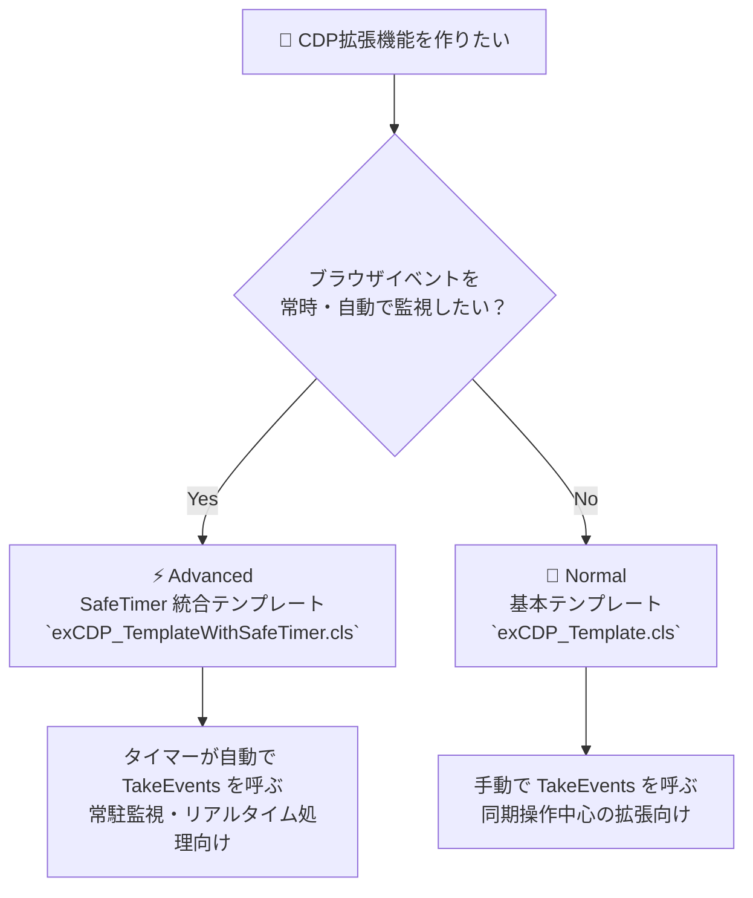

# CDP 拡張機能テンプレート

`CDPContext.cls` / `CDPBrowser.cls` に対して独自の機能拡張を追加するためのテンプレート集です。\
用途に応じて **Normal** と **Advanced** の2種類から選んでご利用ください。

***

## 📁 ディレクトリ構成

```
ForDevelopers/TemplateExtensions/CDP/
├── Normal/
│   └── exCDP_Template.cls                  ← 基本テンプレート
└── Advanced/
    ├── exCDP_TemplateWithSafeTimer.cls     ← SafeTimer 統合テンプレート
    ├── SafeTimer.cls                       ← VBA-SafeTimer 本体
    ├── LibTimers.bas                       ← VBA-SafeTimer サポートモジュール
    └── TimerForm.frm / .frx               ← VBA-SafeTimer サポートフォーム
```

***

## 🔰 Normal — 基本テンプレート

**`Normal/exCDP_Template.cls`**

### こんな用途に

* CDP の非同期イベントを受け取り、何らかの処理を行いたいとき

* 継承した `CDPContext`（`ex_CDPContext.ExecuteCDP`）を使って CDP コマンドを送信したいとき

* **ほとんどのケースはこちらで十分です**

### 仕組み

```
CDPContext（タブ）
  └── WithEvents ex_CDPContext ── ExEvent → タブ向けの処理をここに書く
CDPBrowser（ブラウザ）※必要な場合のみ
  └── WithEvents ex_CDPBrowser ── ExEvent → ブラウザ向けの処理をここに書く
```

`Init` で受け取った `CDPContext`（と、その親の `CDPBrowser`）を `WithEvents` で保持します。ブラウザから非同期イベントが届くと、\
`ex_CDPContext_ExEvent`（このタブ宛て）/ `ex_CDPBrowser_ExEvent`（ブラウザ単位）が呼び出されます。\
`ex_CDPContext_ExEvent` には**このタブ宛てのイベントだけ**が届くため、SessionID の判定は不要です。\
`TakeEvents` を手動で呼ぶことでイベントをポーリングします。

### 主な構成要素

| プロシージャ / プロパティ                    | 役割                                                                 |
| ---------------------------------- | ------------------------------------------------------------------ |
| `Init(Inheritance As CDPContext)`  | `CDPContext` を継承する初期化メソッド。ブラウザ単位のイベントが要らなければ、`ex_CDPBrowser` の行は消して構いません |
| `EnableEvents` プロパティ               | 非同期イベント処理の ON/OFF スイッチ                                             |
| `ex_CDPContext_ExEvent`            | このタブ宛ての非同期イベントのハンドラ（ここに実装する）                                       |
| `ex_CDPBrowser_ExEvent`            | ブラウザ単位の非同期イベント（`Target.targetCreated` など）のハンドラ（ここに実装する）              |
| `Main01`                           | 独自機能の実装場所（自由に追加・改名してOK）                                            |
| `printMsg`                         | ログ出力のラッパー。ログの設定はツール全体で共通で、この拡張側は識別ID（`m_LogID`）だけ持ちます              |
| `TakeEvents`                       | イベントをポーリングして発火させる                                                  |

### 導入ファイル

```
exCDP_Template.cls  ← これだけインポートすればOK
```

***

## ⚡ Advanced — SafeTimer 統合テンプレート

**`Advanced/exCDP_TemplateWithSafeTimer.cls`**

### こんな用途に

* ブラウザの非同期イベントを、**自分でポーリングしなくても自動的に監視**させたいとき

* バックグラウンドで継続的にイベントを処理し続ける常駐型の拡張機能を作りたいとき

* ダウンロード監視・通信傍受・ページ状態監視など、**リアルタイム性が求められる処理**を実装するとき

### 仕組み

```
CDPContext（タブ）
  └── WithEvents ex_CDPContext ── ExEvent → タブ向けの処理をここに書く
CDPBrowser（ブラウザ）※必要な場合のみ
  └── WithEvents ex_CDPBrowser ── ExEvent → ブラウザ向けの処理をここに書く

SafeTimer.cls  ← Windows SetTimer API による定期タイマー
  └── WithEvents st
        └── st_TimerCall → TakeEvents を自動呼び出し
                               ↓
                        イベントが自動発火
```

`VBA-SafeTimer`（[元リポジトリ](https://github.com/cristianbuse/VBA-SafeTimer)）の機能を `StarterWebScrapingKit` に合わせて統合したテンプレートです。\
`StartAsyncTakeEvents` を1回呼ぶだけで、指定間隔（デフォルト 50ms）ごとに\
`TakeEvents` が自動的に呼ばれ、CDP 非同期イベントを継続監視し続けます。

### Normal との違い

| 比較項目               | Normal        | Advanced                 |
| ------------------ | ------------- | ------------------------ |
| `TakeEvents` の呼び出し | 手動（自分でループを書く） | 自動（タイマーが定期呼び出し）          |
| 常駐監視               | ❌ 非対応         | ✅ 対応                     |
| ブレーク時の安全性          | —             | ✅ デバッグ中はタイマー停止（クラッシュしない） |
| 導入コスト              | 低い（1ファイル）     | やや高い（4ファイル）              |
| 向いている用途            | 同期的な操作中心の拡張   | リアルタイム監視・常駐型の拡張          |

### 主な追加要素（Normal との差分）

| プロシージャ                                 | 役割                                |
| -------------------------------------- | --------------------------------- |
| `StartAsyncTakeEvents(msec, addData)`  | タイマーを起動し、イベント自動監視を開始する            |
| `st_TimerCall`                         | タイマーコールバック。内部で `TakeEvents` を呼ぶだけ |

### 導入ファイル

```
exCDP_TemplateWithSafeTimer.cls   ← メインテンプレート
SafeTimer.cls                     ← VBA-SafeTimer 本体
LibTimers.bas                     ← サポートモジュール
TimerForm.frm / .frx              ← サポートフォーム
```

> [!NOTE]
> `TimerForm` はフォームを新規作成して `TimerForm` にリネームすることでも代替できます。\
> 詳細は [本家リポジトリ](https://github.com/cristianbuse/VBA-SafeTimer) を参照してください。

***

## 🤔 どちらを使う？ 判断フローチャート



***

## 🚀 クイックスタート

### Normal の場合

```vba
' 使用例（呼び出し元）
Dim t As CDPContext
Set t = ShSetting01_StartBrowser.StartCDPModeContext

Dim ex As New exCDP_Template
ex.Init t                    ' CDPContext を継承
ex.Main01 "arg1", "arg2"
```

### Advanced の場合

```vba
' 使用例（呼び出し元）
Dim t As CDPContext
Set t = ShSetting01_StartBrowser.StartCDPModeContext

Dim ex As New exCDP_TemplateWithSafeTimer
ex.Init t                            ' CDPContext を継承
ex.StartAsyncTakeEvents 50           ' 50ms 間隔でイベント自動監視開始
ex.Main01 "arg1", "arg2"
```

***

## 📝 テンプレートを使って拡張機能を作る流れ

1. 対応するフォルダのファイルを `StarterWebScrapingKit`にインポートする
2. クラス名を用途に合わせてリネームする（例: `exCDP_DownloadWatcher`）
3. `ThisClassName` 定数もリネームに合わせて変更する
4. `ex_CDPContext_ExEvent`（タブ向け）/ `ex_CDPBrowser_ExEvent`（ブラウザ向け）の `Select Case` に、\
   監視したい CDP イベント名（例: `"Page.downloadWillBegin"`）を追加する
5. `Main01` などのパブリックメソッドに、独自のロジックを実装する

***

## 🧪 補足：`CDPCore` から直接イベントを受け取る方法

テンプレートは、通信コア（`CDPCore`）に触れずに済む `ExEvent` 方式です。ただし、`CDPCore` のイベントを直接受け取る方法も残っています。

### 使いどころ

* **全タブに対する共通処理**：`CDPContext` の `ExEvent` には、そのタブ宛てのイベントしか届きません。`CDPCore` の `CDPContextEvent(methodName, RawJson, sessionID)` なら、**全タブ分のイベントが `sessionID` 付きで1か所に届く**ため、タブをまたいだ集計や監視をまとめて書けます
* **特殊な構成**：WebView2 のように、`CDPContext` / `CDPBrowser` の外側でイベントを受けたい場合

### 受け取り方

`CDPCore` は、起動・再接続のオプションオブジェクトから取り出します。オプションオブジェクトは起動・再接続のあとで破棄されるため、**起動・再接続の前**に取り出してください。

```vba
' 起動の場合（BrowserCapabilities から）
Dim CoreEvent As CDPCore
Set CoreEvent = BrowserCapabilities.ClsGet_CDPCore

Dim chrome As New CDPBrowser
chrome.OpenBrowser BrowserCapabilities

' 再接続の場合（ReattachOptions から。経路の設定後に取り出す）
' ReattachOptions.Set_PipeMode = UserName
' Set CoreEvent = ReattachOptions.ClsGet_CDPCore
' chrome.reattach ReattachOptions
```

```vba
' 拡張クラス側
Private WithEvents ex_CDPCore As CDPCore

Friend Sub InitCore(Inheritance As CDPCore)
    Set ex_CDPCore = Inheritance
End Sub

' 全タブ分のイベントが、sessionID 付きで届く
Private Sub ex_CDPCore_CDPContextEvent(methodName As String, RawJson As String, sessionID As String)
End Sub

' ブラウザ単位のイベント
Private Sub ex_CDPCore_CDPBrowserEvent(methodName As String, RawJson As String)
End Sub
```

* 特定のタブだけを処理したい場合は、`sessionID` を `CDPContext.CurrentSessionID` と比べて判定します
* `ClsGet_` で始まるプロパティは、本来はクラス内部向けです。`CDPCore` はツールの心臓部なので、イベントを受け取る以外の操作はしないでください

### 参考にできる実装

| ファイル | 内容 |
| --- | --- |
| `src/forms/WebView2Form.frm` の `StartCDPModeWebView2` | `ReattachOptions.ClsGet_CDPCore` から `CDPCore` を受け取り、UserForm 内でイベントを処理する例 |
| `ForDevelopers/OperationCheck/CDP/TestVBA/負荷テスト/exCDP_PageLoadWatcherForCore.cls` | `exCDP_PageLoadWatcher.cls` を、`CDPCore` から直接受け取る形にした版（`InitCore` で受け取る） |
| タグ `従来通りのCDPCoreからのイベント受け取りの方法メモ` | 上記ファイルを追加したコミット。`Test_AsyncBenchmark.bas` 側の呼び出し方（`BrowserCapabilities.ClsGet_CDPCore` → `InitCore`）も入っています |

***

*元となる* *`VBA-SafeTimer`* *ライブラリ:* *[cristianbuse/VBA-SafeTimer](https://github.com/cristianbuse/VBA-SafeTimer)*
