# WebDriverEmulation-VBA

**～ 令和のIE ～**

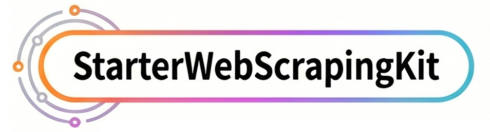

> [!CAUTION]
> **一般の方向けのツールではありません。**  
> 「なぜ動かないのか」ではなく、「**どうやって動いているのか**」を低レイヤーから理解したい方のための研究リポジトリ（POC）兼、備忘録です。  
> 実務で安定したスクレイピングを行いたい方は、[下記の定番ツール](#%EF%B8%8F-実務で使うなら)をご利用ください。

---

## これはなに？

WebDriver（`msedgedriver.exe` / `chromedriver.exe` など）が担っている役割を、**VBAだけ**でどこまで再現できるかを検証するPOCです。

外部ドライバ、SeleniumBasic、COM DLLの登録、管理者権限は**一切使いません**。  
Excel VBA（標準モジュール／クラスモジュール）と Windows 標準API だけで、Chromium系ブラウザ（Edge / Chrome）や WebView2 と直接会話します。（実は [Firefox](#-実はfirefox-も動きます) も少しだけ）

---

## 立ち上げたきっかけ

### 1. IEの時代 ― 橋渡しは0枚

VBAでブラウザを自動操作していたIEの時代は、何の準備もなく、たったこれだけで自動化を始められました。

```vb
Dim ie As Object
Set ie = CreateObject("InternetExplorer.Application")   '← この1行でブラウザが立ち上がる
ie.Visible = True
ie.Navigate "https://www.example.com/"
```

技術的なフローは、これだけです。

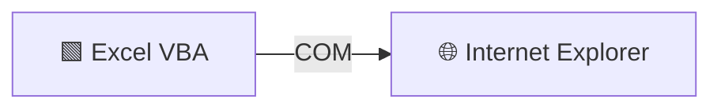

### 2. SeleniumBasic の時代 ― 橋渡しは2枚

IEのサポートが終了し、まず選択肢に入ったのが **SeleniumBasic** でした。

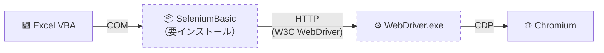

IEの頃と比べると、橋渡し役が **2つ** も増えてしまいました🫠

### 3. TinySeleniumVBA / SeleniumVBA の時代 ― 橋渡しは1枚

その後、[uezo氏（TinySeleniumVBA）](https://github.com/uezo/TinySeleniumVBA) や [GCuser99氏（SeleniumVBA）](https://github.com/GCuser99/SeleniumVBA) により、VBAから直接 WebDriver へHTTPを投げる方式が登場。橋渡しが1枚削られ、現在に至ります。

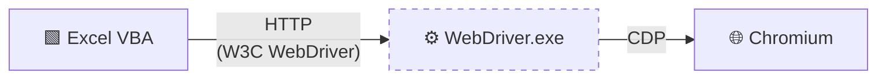

SeleniumBasic はインストールが必要だったため、当初は確かに導入のハードルがありました。  
しかし `WebDriver.exe` だけになった今は、ポータブルなexeを適切に配置し、決められたコマンドを打つだけで自動操作の準備が整います。

ある意味、**ゼロインストール**で自動操作できる時代になったと言えます。

### 4. でも、もう一度よく見てください

そうです。IEの頃と比べると、まだ **1枚** 橋渡し役が残っています。

このプロジェクトは、その **最後の橋渡し役を外す** ためのPOCです。

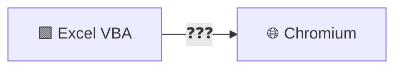

### 振り返り

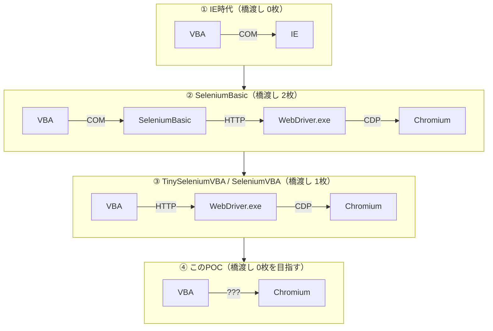

---

## 「???」の正体

WebDriver.exe が最終的にブラウザと交わしているのは **CDP（Chrome DevTools Protocol）** という JSON-RPC 形式のメッセージです。  
であれば、VBAが直接 CDP を話せば WebDriver.exe はいらない――というのが本POCの出発点です。

その「話し方（通信路）」として、現在は次の3つの経路を実装しています。

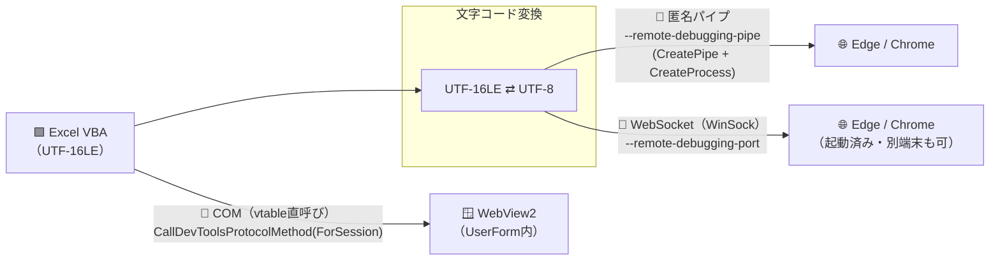

| 経路 | 通信方式 | 主な実装 | ひとこと |
| --- | --- | --- | --- |
| 🥇 **Pipe** | `--remote-debugging-pipe` による匿名パイプ | `CDPCore.cls` | 本POCの主軸。ポートを開かず、親子プロセス間だけで完結する |
| 🥈 **Port** | `--remote-debugging-port` + WinSock による WebSocket | `CDPCoreViaWebSocket.cls` | 起動済みブラウザへの後付け接続や、別端末・Android実機への接続も可能 |
| 🥉 **WebView2** | `ICoreWebView2::CallDevToolsProtocolMethod(ForSession)` | `CDPCoreViaWebView2.cls` / `WebView2Host.cls` | ポートもパイプも開かず、Excelのプロセス内でCDPをやり取りする |

どの経路でも、上位の `CDPContext` / `CDPElement` からは**同じAPI**で操作できるよう抽象化しています。

### 🥇 Pipe 経路の流れ

WebDriver.exe が裏でやっていることを、VBAが肩代わりしている様子です。

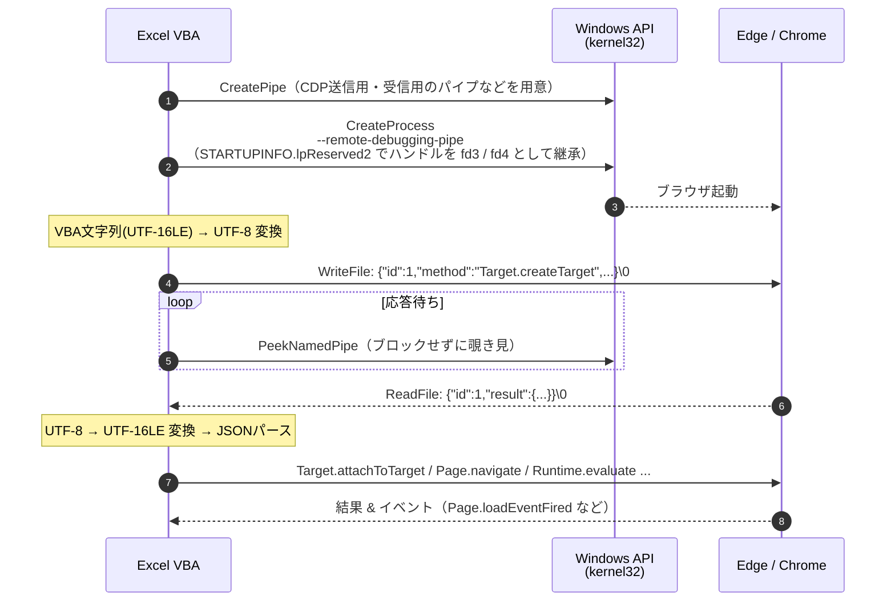

ポイントは次の3点です。

* メッセージの区切りは **NUL文字（`\0`）**。HTTPヘッダもWebSocketフレームもありません
* パイプのハンドルは、CRTのファイルディスクリプタ継承の仕組み（`lpReserved2`）を使って子プロセスへ渡します
* VBA内部は UTF-16LE、CDP は UTF-8 なので、**送受信のたびに相互変換**が必要です

### 🔀 WebDriver BiDi はどうしているの？

W3C で標準化が進む次世代プロトコル **WebDriver BiDi** にも対応しています。  
本来は WebDriver.exe 側が BiDi ⇔ CDP の翻訳を担いますが、本POCでは Google 公式の [chromium-bidi](https://github.com/GoogleChromeLabs/chromium-bidi) の Mapper（`assset/mapperTab.js`）をブラウザ内の専用タブに注入し、**ブラウザ自身に翻訳させて**います。

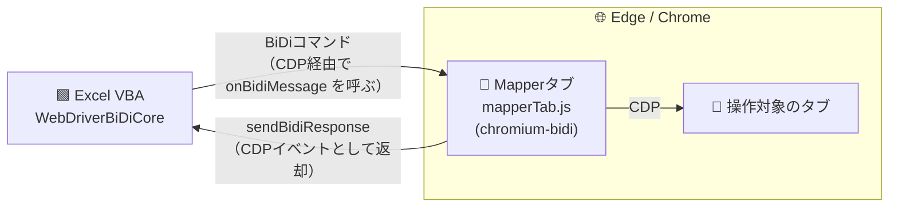

* Mapperタブには `Target.exposeDevToolsProtocol` で CDP の操作権を渡しています
* BiDi で足りない部分は、`WebDriverBiDiContext.UpgradeBiDiPlus` により同じタブを CDP 制御へ切り替えられます（BiDi+）

### 🦊 実は、Firefox も動きます

Chromium 向けに作ったこの仕組みですが、実は **Firefox も同じコードで動かせます**。

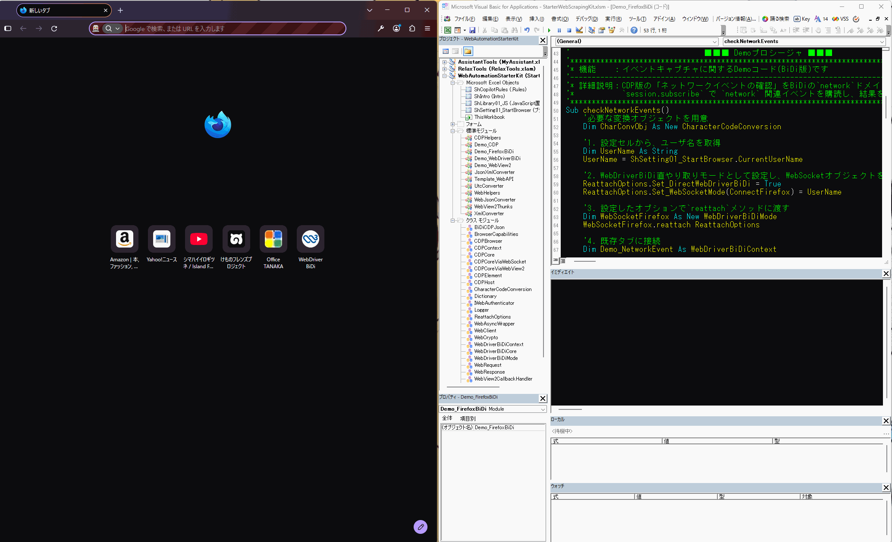

Chromium は BiDi を話せないので Mapper に翻訳させていました。一方 Firefox は、**WebDriver BiDi をネイティブで話せます**。  
そこで翻訳機を外し、BiDi の JSON を WebSocket でそのまま Firefox に送っています。

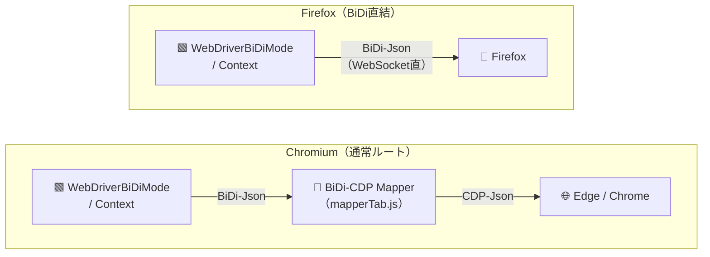

* 上側の `WebDriverBiDiMode` / `WebDriverBiDiContext` は、**Chromium のときと同じ使い方**です（`navigate` / `getTab` / `SubscribeBiDiEvent` など）
* 切り替えは、`ReattachOptions.Set_DirectWebDriverBiDi = True` の **1プロパティ**だけです
* `src/` への追加は **3ファイルで81行追加・6行削除**にとどまり、Firefox 専用のクラスは作っていません。Chromium 向けに積み上げてきた設計（責務分離と `RaiseEvent`、「BiDi で会話する側」としての `WebDriverBiDiMode`、`ReattachOptions`）が、そのまま下地になりました

「Chromium で積み上げた設計が、本物の WebDriver BiDi にもそのまま通用した」という、ちょっとした答え合わせです。

> [!NOTE]
> コア（`src/`）への追記が必要なため、メインの配布物には含めていません。  
> 使い方・制約・コア側の追記内容は [`ex-Firefox` ブランチの ReadMe](https://github.com/Eschamali/StarterWebScrapingKit/blob/ex-Firefox/Extensions/MainUnit/WebDriverBiDi/Firefox/ReadMe.md) にまとめています。  
> 接続は WebSocket ルートのみで、BiDi+ や `CDPContext` / `CDPElement` など Chromium 固有の機能は使えません。

---

## WebDriver の仕事を分解すると

「WebDriverがいらない」と言っても、WebDriverがやっていた仕事が消えるわけではありません。VBA側で一つずつ肩代わりしています。

| WebDriver.exe の役割 | 本POCでの肩代わり先 |
| --- | --- |
| ブラウザプロセスの起動・引数組み立て | `CDPHost.cls` / `CDPCore.cls`（`CreateProcess`） |
| ブラウザとの通信路の確保 | 匿名パイプ / WinSock / WebView2 COM |
| メッセージのシリアライズ | 独自の高速JSONパーサー（`BiDiCDPJson.cls` など） |
| 文字コードの扱い | `CharacterCodeConversion.cls`（UTF-16LE ⇄ UTF-8） |
| セッション・タブ（Target）の管理 | `CDPBrowser.cls` / `CDPContext.cls` |
| 要素検索・クリック・入力 | `CDPElement.cls`（`DOM` / `Runtime` / `Input` ドメイン） |
| イベントの購読 | CDPイベント / BiDiイベントのキューイング |
| W3C WebDriver BiDi 対応 | chromium-bidi Mapper の注入（`WebDriverBiDiCore.cls`） |
| ブラウザとドライバのバージョン整合 | **不要**（ブラウザ本体の CDP を直接使うため） |

### VBA内部で付与している主な起動引数

| 引数名 | 意味 |
| --- | --- |
| `remote-debugging-pipe` / `remote-debugging-port` | 外部プロセス（Excel）からのデバッグ接続を受け付けさせます。`pipe` は同一PCの親子プロセス間でのみ有効です。`port` は `0`（空きポートの自動割り当て）で起動し、接続先は `DevToolsActivePort` ファイルから取得します |
| `user-data-dir` | プロファイルの保存先。[デバッグ機能を悪用したCookie盗難対策](https://developer.chrome.com/blog/remote-debugging-port?hl=ja)により、既定の `User Data` 以外を指定する必要があります。既定では同階層に `Automation Data` を作成します |
| `homepage` | 余計な通信を抑えるため `about:blank` を指定します |
| `app` | 最初のURLを指定した場合に付与。タブ生成やURL変更をある程度防げます（簡易キオスクモード） |

設定シート側で付与している引数（`no-first-run`, `disable-sync`, `enable-automation` など）や、より詳しい仕組みは [公式ドキュメント](https://eschamali.github.io/StarterWebScrapingKit/) にまとめています。

---

## 研究上の縛り（制約）

POCとしての意味を保つため、次のルールを自らに課しています。

1. SeleniumBasic や外部COM DLLの登録を前提としない
2. `msedgedriver.exe` / `chromedriver.exe` などの外部バイナリを配置・要求しない
3. 管理者権限が必要なレジストリ操作やインストーラーを実行しない
4. Python / PowerShell などの別スクリプトを生成・実行しない（**VBA単体で完結**）

---

## 最小コード

設定シート（ブラウザ起動設定）の内容でブラウザを起動し、ページを開いて閉じるだけの例です。

```vb
Sub CDPによる冒険の始まり()
    Dim t As CDPContext
    Set t = ShSetting01_StartBrowser.StartCDPModeContext   '既定は Pipe 経路

    t.navigate "https://www.example.com/"

    t.ThisCDPBrowser.quit
End Sub
```

```vb
Sub BiDiによる冒険の始まり()
    Dim t As WebDriverBiDiContext
    Set t = ShSetting01_StartBrowser.StartBiDiModeContext

    '↓ここに処理を書く↓

    t.ThisWebDriverBiDiMode.quit
End Sub
```

* Port経路は、設定シートの「WebSocketモード」をONにするだけで切り替わります（コードの変更は不要）
* 起動済みブラウザへのアタッチは `Demo_CDP`、WebView2 は `Demo_WebView2` に同梱デモがあります

> [!NOTE]
> ダウンロードしたブックを開くと「保護ビュー」が表示され、マクロが動かないことがあります。  
> Excelを閉じてからファイルを右クリック →「プロパティ」→「**許可する**」にチェックを入れて OK を押してください。（Mark of the Web の解除）

---

## 📚 ドキュメント

API リファレンス、アーキテクチャ、開発秘話などは GitHub Pages にまとめています。

➡️ **[公式ドキュメント](https://eschamali.github.io/StarterWebScrapingKit/)**

---

## 🛠️ 実務で使うなら

一般的なWebスクレイピングやブラウザ自動化が目的であれば、成熟した次のツールを強くおすすめします。

| ツール | 言語 | ひとこと |
| --- | --- | --- |
| [Playwright](https://playwright.dev/) | Node.js / Python / .NET / Java | 現代の定番。複数ブラウザ対応、待機処理も賢い |
| [Puppeteer](https://pptr.dev/) | Node.js | CDP 直結の元祖的存在。本POCの発想の源のひとつ |
| [Selenium](https://www.selenium.dev/) | 各種 | W3C WebDriver の本家 |
| [TinySeleniumVBA](https://github.com/uezo/TinySeleniumVBA) | VBA | 軽量。VBAから WebDriver を直接叩く方式の先駆け |
| [SeleniumVBA](https://github.com/GCuser99/SeleniumVBA) | VBA | 高機能。VBAでの実務利用ならまずこちら |

本リポジトリは、あくまで「最後の橋渡しを外したらどうなるか」を確かめるための**研究リポジトリ**という立ち位置です。

---

## 【Credits & Acknowledgments】

このPOCは、世界中のVBA職人や開発チームが公開してくれた素晴らしいライブラリの数々の上に成り立っています。  
偉大な先人たちの知恵とコードに、心からの敬意と感謝を表します。

* **WebSocket実装のコアロジック**
  * [ChromeControler-No-Selenium-WebDriver-VBAJSON](https://github.com/24000/ChromeControler-No-Selenium-WebDriver-VBAJSON)
    * 製作者：[@kabkabkab](https://qiita.com/kabkabkab/items/9952a796ee9244fc98ad)氏
* **CDP制御・パイプ通信の基盤**
  * [Chromium-Automation-with-CDP-for-VBA](https://github.com/longvh211/Chromium-Automation-with-CDP-for-VBA)
    * 製作者：longvh211氏
* **WinHTTP 5.1 ラッパー**
  * [VBA-Web](https://github.com/VBA-Tools-v2/VBA-Web)
    * オリジナル製作者：Tim Hall氏
* **CDP/WebDriverBiDiレスポンス専用の超高速JSONパーサー**
  * [vbacollective-json](https://github.com/vbacollective/json)
    * 製作者：Ueslei Paim
    * `CopyMemory`不使用版に改良
* **`VBA-JSON`の上位互換の高速JSONパーサー**
  * [VBA-FastJSON](https://github.com/cristianbuse/VBA-FastJSON)
    * 製作者：Cristian Buse
* **Microsoft製 `Scripting.Dictionary`の上位互換の高速Dictionary**
  * [VBA-FastDictionary](https://github.com/cristianbuse/VBA-FastDictionary)
    * 製作者：Cristian Buse
* **高速な文字コード変換ラッパー**
  * [How to convert VBA/VB6 Unicode strings to UTF-8](https://di-mgt.com.au/howto-convert-vba-unicode-to-utf8.html)
    * David Ireland DI Management Services Pty
  * [VBAで Windows APIを使った UTF-8 ←→ Unicode相互変換](https://qiita.com/yamashiroakihito/items/9b609653fef6fa8a5ab2)
    * 製作者：@yamashiroakihito
* **ログレベルの基礎部分**
  * [VBA-Log](https://github.com/VBA-tools/VBA-Log)
    * 製作者：timhall氏
* **ChromiumブラウザをBiDi化するためのコアロジック**
  * [chromium-bidi](https://github.com/GoogleChromeLabs/chromium-bidi)
    * 製作者：GoogleChromeLabsチーム
* **UserFormにWebView2を追加DLなしで埋め込んだすごい方**
  * [WebView2-For-Excel-VBA](https://github.com/tarboh/WebView2-For-Excel-VBA)
    * 製作者：[たーぼー氏](https://x.com/fenblen_puyo)
* **「VBAから直接WebDriverへ」の道を切り拓いた方々**
  * [TinySeleniumVBA](https://github.com/uezo/TinySeleniumVBA)
    * 製作者：uezo氏
  * [SeleniumVBA](https://github.com/GCuser99/SeleniumVBA)
    * 製作者：GCuser99氏
