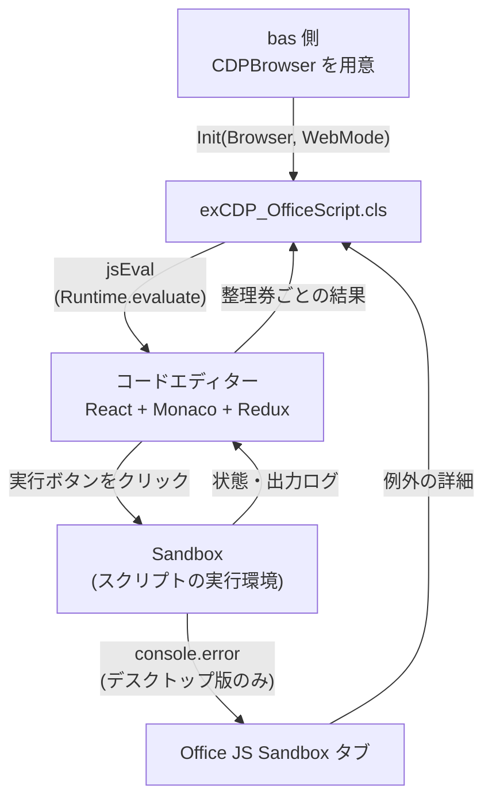

# Officeスクリプト

Google で検索しても、出てくるのは次のような答えばかりでした。

- VBA から、Officeスクリプトはいじれません

VBA から Officeスクリプトをいじっている様子は、見当たりませんでした。

み～んな、

- Power Automate でやりましょう

ばっかりです。自分でも分かります。実務ではそれがベストです。

でも…でも、やっぱりいじりたいんです、VBA で。もうね、意地です、意地。

ただ、それっぽいものは海外にありました。VBA から HTTP でリクエストを送って Power Automate のフローを動かし、そのフローから Officeスクリプトを実行する、という回り道です。

しかしこの方法には、Power Automate のプレミアムライセンスが必要です。しかも、フローの URL を知っていれば誰でもどこからでも実行できてしまうので、URL の扱いにも気を付けないといけません。なにより、結局は Power Automate 頼みで、VBA から Officeスクリプトを直接いじっている感じはしません。

Officeスクリプトは、2020年に Web 版 Excel のプレビューとして登場しました。それから今まで、VBA から公式に実行したり編集したりする方法は、長らく現れませんでした。

しかし、この CDP×VBA ツールの登場と成長により、ついに VBA から Officeスクリプトの実行に成功しました。

## 概要

[からくり](/breakthrough/mechanism) を使うと、VBA から Officeスクリプトを動かせます。

Officeスクリプトは、Excel の作業を TypeScript か JavaScript で自動化する仕組みです。Microsoft のドキュメントでも、VBA マクロはデスクトップ向け、Officeスクリプトはクロスプラットフォームでクラウド向けという、別々の仕組みとして説明されています。

その Officeスクリプトのコードエディターも、WebView2 で作られています。そこで、コードエディターに CDP で接続して、VBA から次のことをできるようにしました。

- VBA で用意したスクリプトを、コードエディターに書き込んで実行する
- 実行の結果、console.log の出力、例外の詳細を、VBA で受け取る

拡張は `Extensions` ブランチの [`Extensions/MainUnit/CDP/OfficeScriptViaVBA`](https://github.com/Eschamali/StarterWebScrapingKit/tree/Extensions/Extensions/MainUnit/CDP/OfficeScriptViaVBA) にあります。

::: warning
POC から生まれた実装です。コードエディターの内部構造（React / Redux）を直接読み書きしているため、Office 側の更新で動かなくなる可能性があります。
:::

## Web 版 Excel にも使える

デスクトップ版だけでなく、Edge で開いた Web 版 Excel にも同じ方法で接続できます。

Web 版 Excel のシートは、HTML の DOM ではなく Canvas で描画されています。Excel チームが2年かけて DOM から Canvas へ描画を移した、と2021年に紹介されています。そのため、画面の DOM からはセルの値を扱いにくくなっています。

Officeスクリプト経由なら、Canvas を通さずにセルの値を読み書きできます。

## ファイル構成

```
OfficeScriptViaVBA/
├── exCDP_OfficeScript.cls    ← Officeスクリプトの書き込み・実行・結果の受け取りを行う拡張クラス
├── Demo_OfficeScript.bas     ← CDPBrowser の用意 (デスクトップ版 / Web 版) と、Demo 01〜05
├── Demo_OfficeScript_Showcase.bas  ← 録画向けのショーケース (描画 3本・読み取り 2本)
└── ReadMe.md                 ← 使い方と仕組みの詳細
```

## 動作条件

| 項目 | デスクトップ版 Excel | Web 版 Excel |
| --- | --- | --- |
| 接続先 | Office の WebView2 | Excel を開いている Edge |
| ユーザーデータフォルダー | `%LOCALAPPDATA%\Microsoft\Office\16.0\Wef\webview2\2\1\EBWebView` | `%LOCALAPPDATA%\Microsoft\Edge\User Data` |
| 事前準備 | [自動化] タブからスクリプトを開き、コードエディターを表示しておく | Edge のリモートデバッグを有効にし（`edge://inspect/#remote-debugging` で許可など）、Web 版 Excel でコードエディターを表示しておく |
| コードエディターの場所 | タブ（タイトル「コード エディター」） | Excel のページの中の iframe（URL に `index.html#/edit` を含む） |
| 例外の詳細 | 「Office JS Sandbox」タブから受け取る（name / message / stack） | エディターの出力ログから受け取る（message のみ） |

## 使い方

### 1. CDPBrowser を用意する

接続と切断は、bas 側で行います。`Demo_OfficeScript.bas` の `ConnectDesktopExcel` と `ConnectWebExcel` が、そのまま使える実装例です。

```vb
'デスクトップ版 Excel（Office の WebView2）へ接続する例
Dim UserDataDir As String
UserDataDir = Environ("LOCALAPPDATA") & "\Microsoft\Office\16.0\Wef\webview2\2\1\EBWebView"

BrowserCapabilities.Set_UserDataDirName = UserDataDir
Dim WebSocketCDP As CDPCoreViaWebSocket: Set WebSocketCDP = New CDPCoreViaWebSocket
WebSocketCDP.EnsureWebView2DebugPort = 0                 'Web 版ではこの行は不要
If Not WebSocketCDP.AutoConnectDevToolsActivePort(BrowserCapabilities) Then Exit Sub

ReattachOptions.Set_WebSocketMode(WebSocketCDP) = UserDataDir
Dim Browser As New CDPBrowser
Browser.reattach ReattachOptions
```

Web 版の場合は、`UserDataDir` を Edge のユーザーデータフォルダーにして、`EnsureWebView2DebugPort` の行を外します。

### 2. コードエディターを確保して実行する

```vb
Dim os As New exCDP_OfficeScript
If Not os.Init(Browser) Then Exit Sub                    'デスクトップ版
'If Not os.Init(Browser, WebMode:=True) Then Exit Sub    'Web 版

Dim Script As String
Script = "function main(workbook: ExcelScript.Workbook) {" & vbLf & _
         "    workbook.getActiveWorksheet().getRange(""A1"").setValue(""Hello"");" & vbLf & _
         "    console.log(""done"");" & vbLf & _
         "}"

Debug.Print os.RunScript(Script)     '→ Succeeded / Failed / Timeout など
Debug.Print os.LastLogs              '状態の遷移、出力ログ、メッセージバーの内容
```

### 3. 非同期で実行する（整理券方式）

`RunScriptAsync` は、実行を始めた時点で整理券番号を返します。結果は、整理券番号を渡して後から受け取ります。

```vb
Dim Ticket As Long
Ticket = os.RunScriptAsync(Script)
If Ticket = 0 Then Debug.Print "開始できませんでした: " & os.LastLogs: Exit Sub

'(VBA 側で別の作業)

Debug.Print os.WaitResult(Ticket, 60)            '完了まで待つ
'または、待たずに1回だけ確認する
'If os.TryGetResult(Ticket, Status) Then Debug.Print Status
```

`Application.OnTime` で結果を受け取る場合は、`exCDP_OfficeScript` と `CDPBrowser` の両方をモジュールレベル変数で持っておきます。

::: warning デスクトップ版で、ブックの読み取りが多いスクリプトを動かすとき
デスクトップ版の Officeスクリプトは、Excel と同じプロセスで動きます。そのため、`RunScript` や `WaitResult` で VBA が待っている間は、スクリプトのブックへの問い合わせが進まないことがあります。

実際に、全シートを読み取るショーケースの「ブック棚卸し」では、手動で実行すると数十秒で終わるのに、VBA から同期で待つと結果が返らずにタイムアウトし、マクロが終わった直後に結果が届きました。

`RunScriptAsync` で実行を始めたらマクロをいったん終え、`Application.OnTime` で `TryGetResult` を定期的に呼ぶ形にすると、最後まで実行できます。Web 版では、この問題は起きませんでした。
:::

### 4. 例外の詳細を見る

```vb
If Not os.LastExceptionDetails Is Nothing Then
    Debug.Print os.LastExceptionMessage                      'intentional error from VBA
    Debug.Print os.LastExceptionDetails.StringKey("stack")   'デスクトップ版のみ
End If
```

### 5. 後片付け

`os.Dispose` でコードエディターへの参照を手放してから、bas 側で切断します。

```vb
os.Dispose
Browser.DisconnectCDP
```

::: tip 注意
この順番は守る必要があります。`CDPContext` は破棄されるときに `Target.detachFromTarget` などを送るため、先に切断すると、閉じたソケットへの送信になり、WinSock のエラー 10038 が出ます。`DisconnectCDP` は CDP の接続を閉じるだけで、Excel や Edge は閉じません。
:::

## 主な API

| メンバー | 内容 |
| --- | --- |
| `Init(Inheritance, [WebMode], [EditorKey])` | 接続済みの `CDPBrowser` を受け取り、コードエディターを確保します。確保できれば True |
| `Dispose` | コードエディターと Sandbox への参照を手放します。`CDPBrowser` は切断しません |
| `RunScript(Raw, [TimeoutSec])` | 書き込んで実行し、完了まで待って状態を返します |
| `RunScriptAsync(Raw)` | 書き込んで実行を始め、整理券番号を返します。始められなければ 0 |
| `TryGetResult(TicketID, [Status])` / `WaitResult(TicketID, [TimeoutSec])` | 整理券番号で結果を受け取ります |
| `IsRunning` | スクリプトの実行中かどうか |
| `LastStatus` / `LastLogs` / `LastOutputs` | 直近の状態、ログ全文、出力ログ |
| `LastExceptionDetails` / `LastExceptionMessage` | 直近の例外の詳細（`BiDiCDPJConv`）とメッセージ |

状態は `Succeeded` / `Failed` / `Unsupported` / `Timeout` / `NotStarted` / `Error` のどれかです。詳しくは [ReadMe](https://github.com/Eschamali/StarterWebScrapingKit/blob/Extensions/Extensions/MainUnit/CDP/OfficeScriptViaVBA/ReadMe.md) を参照してください。

## 仕組み



### Monaco Editor と Officeスクリプトの関係

Officeスクリプトのコードエディターは、Microsoft のドキュメントで「Visual Studio Code をもとにしている」と説明されています。実際、コードエディターの DOM には `.monaco-editor` の要素があり、Web 版の CDP のターゲット一覧には、Monaco が使う `editorWorkerService` と `typescript` の Worker が並んでいました。

Monaco Editor は、VS Code のエディター部分をオープンソースで公開したものです。Officeスクリプトのアプリは、この Monaco Editor を React の部品として組み込み、実行ボタン、出力ログ、保存などを独自に作っています。そのため、この拡張が頼っている部分は、公開されている部分と、Office 独自の部分に分かれます。

| 部分 | 出どころ | この拡張での扱い |
| --- | --- | --- |
| エディターの編集操作（`getModel` / `executeEdits` / `pushUndoStop`） | Monaco Editor の公開 API | そのまま使って、全文を置き換えます |
| React の内部情報と react-redux の `Provider` | React / Redux（オープンソース） | よく知られた調べ方で、エディターと store をたどります |
| エディターの置き場所 | Office 独自 | `window.monaco` が公開されていないため、React の内部情報からさかのぼって探します |
| Redux の state の形（`run.runningStatus` など） | Office 独自 | ドキュメントは無く、実際の store を読んで特定しました |
| Sandbox と例外の出し方（`Command Error:`） | Office 独自 | 実際の出力を見て、受け取り方を決めました |

Office 独自の部分にはドキュメントが無く、Office の更新で変わる可能性があります。冒頭の警告は、主にこの部分への依存によるものです。

### 書き込みと実行

1. コードエディターのページにヘルパー（`window.__exCDP_OfficeScript`）を入れ、Monaco のエディターと Redux の store を掴みます。
2. Monaco の `executeEdits` で全文を置き換え、store に反映されるまで待ちます。
3. ツールバーの「実行」ボタンをクリックします。
4. store の `run.runningStatus` の変化と、メッセージバーの表示をページの中で記録し、整理券番号ごとに結果を保持します。

Officeスクリプトは、エディターに書き込んだ内容を自動で保存します。そのため、開いていたスクリプトの中身は上書きされます。

### 例外の詳細の受け取り方

デスクトップ版では、スクリプトは別のタブ「Office JS Sandbox」で実行されます。例外の詳細は、このタブの `console.error` にだけ「`Command Error:`」の形で出て、エディターには「予期しないエラーが発生しました。」としか届きません。そこで、Sandbox タブの `console.error` を差し替えて、例外を受け取っています。

Web 版では、Sandbox が実行のたびに作り直されるため、この方法は使えません。代わりに、エディターの出力ログに例外のメッセージがそのまま届くので、そこから受け取ります。

### Sandbox のコンソール履歴を捨てる

Sandbox タブは Excel を閉じるまで残り、実行のたびにコンソールの出力がたまっていきます。`CDPContext` は接続時に `Runtime.enable` を送るため、たまった出力がまとめて送られてきます。履歴が約900KB（536件）たまった状態では、接続に16〜22秒かかっていました。

そこで、Sandbox に接続した直後と `Dispose` のときに `Runtime.discardConsoleEntries` を送り、履歴を捨てています。これにより、接続は約2秒で終わるようになりました。

## 既知の制約

- 同時に実行できるのは1本だけです。コードエディターが1つしかないためです。
- `main` に workbook 以外の引数を持つスクリプトは対象外です。パラメーターの入力ダイアログが表示されるためです。
- デスクトップ版では、VBA が同期で待っている間、読み取りの多いスクリプトが進まないことがあります。Officeスクリプトが Excel と同じプロセスで動くためです。`RunScriptAsync` と `Application.OnTime` で結果を受け取ってください。
- デスクトップ版では、Excel を起動して最初の実行の例外は受け取れません。「Office JS Sandbox」タブは、最初の実行が始まったときに作られるためです。1回実行した後に `Init` し直せば受け取れるようになります。
- Web 版で Excel を複数開いている場合は、最初に見つかったコードエディターを確保します。

## 参考資料

### Officeスクリプトの登場

* [Excel操作をJavaScriptで記録 ～Microsoft、“Office Scripts”をパブリックプレビュー](https://forest.watch.impress.co.jp/docs/news/1227931.html)（窓の杜、2020年1月8日。米国時間の1月7日に Web 版 Excel でパブリックプレビューを開始。Microsoft Ignite 2019 でお披露目）

* [Web版「Excel」の新しいマクロ機能「Office スクリプト」が一般リリース](https://forest.watch.impress.co.jp/docs/news/1328019.html)（窓の杜、2021年5月31日。Web 版 Excel で一般公開。デスクトップ版は未サポート）

* [Run your Office Scripts from a workbook button—now on Windows](https://techcommunity.microsoft.com/blog/excelblog/run-your-office-scripts-from-a-workbook-button%E2%80%94now-on-windows/3295787)（2022年4月。Windows 版 Excel で、ブックのボタンからスクリプトを実行できるようになる）

* [Automate tasks with Office Scripts in Excel for Windows and Mac](https://techcommunity.microsoft.com/blog/microsoft365insiderblog/automate-tasks-with-office-scripts-in-excel-for-windows-and-mac/4216151)（元の公開は2022年10月。Windows 版と Mac 版の Excel でスクリプトを作れるようになる）

### VBA と Power Automate

* [Office スクリプトと VBA マクロの違い](https://learn.microsoft.com/ja-jp/office/dev/scripts/resources/vba-differences)（「Office スクリプトは、Power Automate を使用して実行できます」）

* [How to run Power Automate from Excel with Office Scripts or VBA](https://exceloffthegrid.com/power-automate-from-excel/)（Excel Off The Grid、2023年1月。VBA から HTTP で Power Automate のフローを呼ぶ方法。フローからは Officeスクリプトを実行できる。HTTP で起動するトリガーにはプレミアムライセンスが必要で、URL は誰でも実行できるため共有しないよう注意書きがある）

### Officeスクリプト

* [Office Scripts in Excel](https://learn.microsoft.com/en-us/office/dev/scripts/overview/excel)（アクションレコーダーとコードエディター）

* [Office Scripts code editor](https://learn.microsoft.com/en-us/office/dev/scripts/overview/code-editor-environment)（TypeScript か JavaScript で書く。コードエディターは Visual Studio Code をもとにしている）

* [Differences between Office Scripts and VBA macros](https://learn.microsoft.com/en-us/office/dev/scripts/resources/vba-differences)（VBA マクロはデスクトップ向け、Officeスクリプトはクロスプラットフォームでクラウド向け）

### Monaco Editor

* [microsoft/monaco-editor](https://github.com/microsoft/monaco-editor)（Monaco Editor は VS Code のフル機能のコードエディター）

### Web 版 Excel の描画

* [Excel on the web: Microsoft closes the gap on the desktop version](https://www.techrepublic.com/article/excel-on-the-web-microsoft-closes-the-gap-on-the-desktop-version/)（TechRepublic、2021年6月。Excel チームが2年かけて、Web 版の描画を HTML DOM から Canvas へ移した）

### CDP

* [Runtime.discardConsoleEntries](https://chromedevtools.github.io/devtools-protocol/tot/Runtime/#method-discardConsoleEntries)（集めた例外とコンソールの呼び出しを捨てる）

### この拡張

* [`Extensions` ブランチ：`Extensions/MainUnit/CDP/OfficeScriptViaVBA`](https://github.com/Eschamali/StarterWebScrapingKit/tree/Extensions/Extensions/MainUnit/CDP/OfficeScriptViaVBA)（クラス、デモ、ReadMe）
