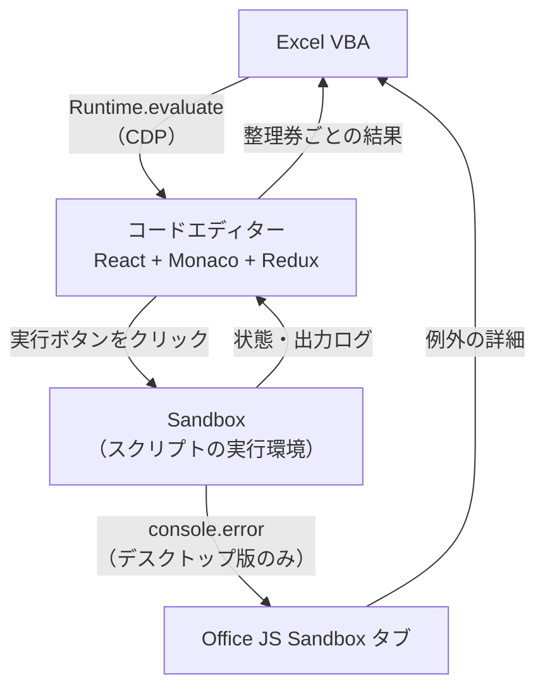
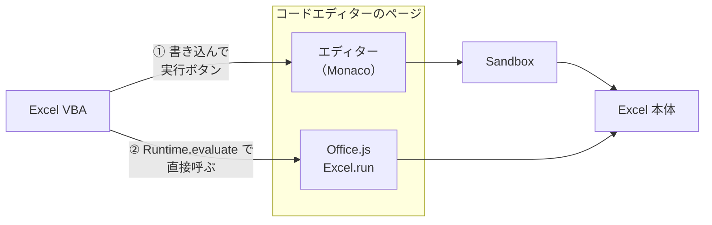

# Officeスクリプト

Google で検索しても、出てくるのは次のような答えばかりでした。

- VBA から、Officeスクリプトはいじれません

VBA から Officeスクリプトをいじっている様子は、見当たりませんでした。

み～んな、

- Power Automate でやりましょう

ばっかりです。自分でも分かります。実務ではそれがベストです。

でも…でも、やっぱりいじりたいんです、VBA で。もうね、意地です、意地。

ただ、それっぽいものは海外にありました。VBA から HTTP でリクエストを送って Power Automate のフローを動かし、そのフローから Officeスクリプトを実行する、という回り道です。

しかしこの方法には、Power Automate のプレミアムライセンスが必要です。しかも、フローの URL を知っていれば誰でもどこからでも実行できてしまうので、URL の扱いにも気を付けないといけません。なにより、結局は Power Automate 頼みで、VBA から Officeスクリプトを直接いじっている感じはしません。

Officeスクリプトは、2020年に Web 版 Excel のプレビューとして登場しました。それから今まで、VBA から公式に実行したり編集したりする方法は、長らく現れませんでした。

しかし、この CDP×VBA ツールの登場と成長により、ついに VBA から Officeスクリプトの実行に成功しました。

## 論より証拠

とりあえずまずは、動いてる様子をご覧ください。

### デスクトップアプリ版

[からくり](/public/img/breakthrough/VBA→OfficejsDemo_Desktop.mp4) 

### WebExcel版

[からくり](/public/img/breakthrough/VBA→OfficejsDemo_Web.mp4) 

### WebExcelから、デスクトップアプリExcelへの転記

[からくり](/public/img/breakthrough/Web→Desktop.mp4) 

## OfficeScript 経由での実行の仕組み

Officeスクリプトのコードエディターは、Web のページです。デスクトップ版では Office が作った WebView2 の中に、Web 版では Excel を開いている Edge のページの中にあります。どちらも Chromium なので、[からくり](/breakthrough/mechanism)で紹介した方法で CDP の接続ができます。

あとは、人がコードエディターでやることを、CDP で代わりにやるだけです。スクリプトを書いて、「実行」ボタンを押して、結果を見る。この3つです。



### 接続

| | デスクトップ版 | Web 版 |
| --- | --- | --- |
| デバッグポート | 環境変数 `WEBVIEW2_ADDITIONAL_BROWSER_ARGUMENTS` で、Office が作る WebView2 のポートを開ける（[からくり](/breakthrough/mechanism)） | Edge 側でリモートデバッグを有効にする（`edge://inspect/#remote-debugging` で許可するなど） |
| 接続先 | Office の WebView2 のユーザーデータフォルダ（`%LOCALAPPDATA%\Microsoft\Office\16.0\Wef\webview2\2\1\EBWebView`）の `DevToolsActivePort` に書かれた、ブラウザ用の WebSocket | Edge のユーザーデータフォルダ（`%LOCALAPPDATA%\Microsoft\Edge\User Data`）の `DevToolsActivePort` に書かれた、ブラウザ用の WebSocket |
| コードエディターの場所 | タブ（タイトル「コード エディター」） | Excel のページの中の iframe（URL に `index.html#/edit` を含む） |

デスクトップ版の環境変数は、WebView2 が起動する前に設定されている必要があります。

`edge://inspect` でリモートデバッグを許可した Edge は、`/json` などの HTTP エンドポイントに `404` を返します。ただ、`DevToolsActivePort` に書かれたブラウザ用の WebSocket には接続できます（[技術資料: WebSocket 経路](/stories/DebugRouteTech/websocket-tech)）。そのため、Web 版もデスクトップ版と同じ方法で接続しています。

Web 版のコードエディターは、デスクトップ版と同じアプリ（同じ React / Redux の構成）です。Excel のページの中に、別プロセスの iframe として置かれています。そのため、iframe のターゲットとして見つけてしまえば、以降の処理は共通です。

なお、Web 版 Excel のシートは、HTML の DOM ではなく Canvas で描画されています（Excel チームが2年かけて DOM から Canvas へ移した、と2021年に紹介されています）。そのため、画面の DOM からはセルの値を扱いにくくなっています。コードエディター経由なら、Canvas を通さずにセルの値を読み書きできます。

### Monaco Editor と Officeスクリプトの関係

Officeスクリプトのコードエディターは、Microsoft のドキュメントで「Visual Studio Code をもとにしている」と説明されています。実際、コードエディターの DOM には `.monaco-editor` の要素があり、Web 版の CDP のターゲット一覧にも、Monaco が使う `editorWorkerService` と `typescript` の Worker が並んでいました。

Monaco Editor は、VS Code のエディター部分をオープンソースで公開したものです。Officeスクリプトのアプリは、この Monaco Editor を React の部品として組み込み、実行ボタン、出力ログ、スクリプトの保存などを独自に作っています。そのため、ここで頼っている部分は、仕様が公開されている部分と、Office 独自の部分に分かれます。

| 部分 | 出どころ | 扱い |
| --- | --- | --- |
| エディターの編集操作（`getModel` / `executeEdits` / `pushUndoStop` / `getFullModelRange`） | Monaco Editor の公開 API | そのまま使って、全文を置き換える。エディターのインスタンスかどうかも、`getModel` と `executeEdits` を持っているかで見分ける |
| React の内部情報（`__reactFiber$...`）と react-redux の `Provider` | React / Redux（オープンソース） | よく知られた調べ方で、エディターと store をたどる |
| エディターのインスタンスの置き場所 | Office 独自 | `window.monaco` が公開されていないため、React の内部情報からさかのぼって探す |
| Redux の state の形（`run.runningStatus` など） | Office 独自 | ドキュメントは無く、実際の store を読み、実行前後の変化を見て特定した |
| 実行ボタン、メッセージバーの表示タイミング | Office 独自 | 動かしたログをもとに、結果を確定する条件を決めた |
| Sandbox と例外の出し方（`Command Error:`） | Office 独自 | 実際の出力を見て、受け取り方を決めた |

Office 独自の部分にはドキュメントが無く、Office の更新で変わる可能性があります。

### コードエディターの掴み方

接続したら、コードエディターのページにヘルパー（`window.__exCDP_OfficeScript`）を入れ、次の2つを掴みます。

- **Monaco Editor のインスタンス**：DOM の `.monaco-editor` から React の内部情報（`__reactFiber$...`）をさかのぼり、`stateNode.editor` を探します
- **Redux の store**：react-redux の `Provider` に渡されている `memoizedProps.store` を探します

store からは、次の状態を読みます。

| state のパス | 内容 |
| --- | --- |
| `run.runningStatus` | `None` → `InProgress` → `Succeeded` / `Failed` / `Unsupported` |
| `bottomPanel.outputLogs` | 出力ログ。`{id, message, severity}` の配列 |
| `bottomPanel.problemsLogs` | 問題ログ |
| `messageBar` | 画面上部の通知（`isVisible`、`text`） |
| `editor.active` | 開いているスクリプトの ID |
| `scripts.scripts[id]` / `scripts.mruScripts` | スクリプトの本文（`localUpdates.body` / `storageScript.body`） |

### 書き込みと実行

1. **書き込み**：Monaco の `executeEdits` で全文を置き換えます。前後に `pushUndoStop` を入れているので、エディター上で Ctrl+Z を押せば元に戻せます
2. **反映待ち**：エディターの変更は、React の onChange を経由して Redux の store に反映されます。store 上の本文が、書き込んだ内容と一致するまで待ちます
3. **実行**：ツールバーの「実行」ボタン（`aria-label` が「実行」または「Run」）をクリックします。実行されるのは、エディター上のまだ保存されていない内容です

Officeスクリプトは、エディターに書き込んだ内容を自動で保存します。そのため、開いていたスクリプトの中身は上書きされます。

### 整理券と結果の確定

実行ボタンをクリックする前に store を購読し、VBA には整理券番号を返します。購読している間は、`runningStatus` の変化とメッセージバーの表示を、ページの中で記録しておきます。VBA は整理券番号で問い合わせるだけなので、好きなタイミングで結果を取りに行けます。

`runningStatus` が終わりの状態になっても、結果のメッセージバー（「スクリプトが正常に実行されました。」など）は少し遅れて表示されます。そのため、次のどちらかを満たした時点で、結果を確定します。

- 「実行中」と「結果」の2件のメッセージがそろい、最後の表示から200ミリ秒たった
- 終わりの状態になってから3秒たった

確定した時点で、その実行で増えた出力ログを整理券ごとに保存し、store の購読をやめます。

### 例外の詳細の受け取り方

デスクトップ版では、スクリプト本体は別のタブ「Office JS Sandbox」で実行されます。例外の詳細は、このタブの `console.error` にだけ、次の形で出力されます。エディターの出力ログには、「予期しないエラーが発生しました。」という決まった文しか届きません。

```
Command Error:
{"message":"...","name":"Error","stack":"Error: ...\n    at main (...)"}
```

Sandbox 側のコードは、`console.error` を呼ぶたびに参照し直しています。そのため、Sandbox タブの `console.error` を差し替えるだけで、例外を受け取れます。CDP のイベントを購読する必要はありません。元の `console.error` もそのまま呼ぶので、Office 側の動作は変わりません。

実行ごとの切り分けには、時刻を使います。整理券ごとに実行を始めた時刻を記録しておき、それ以降に出た例外だけを集めます。エディターと Sandbox は同じ PC の時計を使うので、そのまま比べられます。

Web 版では、Sandbox が `about:srcdoc` の iframe と、その中の Web Worker として作られます。どちらも実行のたびに作り直されるので、差し替えておけません。その代わり、Web 版ではエディターの出力ログに、例外のメッセージがそのまま `severity: "error"` で届きます。そのため、Web 版では出力ログから受け取ります（stack は取れません）。

### Sandbox のコンソール履歴を捨てる

デスクトップ版の Sandbox タブは Excel を閉じるまで残り、実行のたびにコンソールの出力がたまっていきます。CDP で接続して `Runtime.enable` を送ると、たまった出力が `Runtime.consoleAPICalled` としてまとめて送られてきます。履歴が約900KB（536件）たまった状態では、接続に16〜22秒かかっていました。

そこで、Sandbox に接続した直後と、使い終わったときに `Runtime.discardConsoleEntries` を送り、履歴を捨てています。例外は差し替えた `console.error` 側で別に持っているので、受け取りには影響しません。これで、接続は約2秒で終わるようになりました。

### 仕組みから来る制約

- 同時に実行できるのは1本だけです。コードエディターが1つしかないためです
- `main` に workbook 以外の引数を持つスクリプトは対象外です。パラメーターの入力ダイアログが表示されるためです
- デスクトップ版の Officeスクリプトは、Excel と同じプロセスで動きます。そのため、VBA が結果を待っている間は、ブックの読み取りが多いスクリプトが進まないことがあります。実際に、全シートを読み取るスクリプトでは、手動なら数十秒で終わるのに、VBA から待つと結果が返らずにタイムアウトし、マクロが終わった直後に結果が届きました。Web 版では、この問題は起きませんでした
- デスクトップ版では、Excel を起動して最初の実行の例外は受け取れません。「Office JS Sandbox」タブは、最初の実行が始まったときに作られるためです
- Office 側の更新で動かなくなる可能性があります。React の内部情報、Redux の state の形、実行ボタンの `aria-label`、Sandbox の `console.error` の形に頼っているためです

## Officejs としての実行の仕組み

コードエディターのページには、Office.js（`Office` / `Excel` / `OfficeExtension`）が読み込まれていて、Excel 本体とつながっています。Office.js は、Office アドインが Excel を操作するための JavaScript の API です。

つまり、エディターに書き込んで実行ボタンを押さなくても、そのページで `Excel.run` を直接呼べば、Excel を操作できます。VBA からは、`Runtime.evaluate` で次のような JavaScript を送っているだけです。

```js
Excel.run(async (context) => {
    // ここに VBA から渡した中身が入る
    const r = context.workbook.getSelectedRange();
    r.load("address");
    await context.sync();
    return r.address;
});
```



① が OfficeScript 経由、② が Officejs としての実行です。

### 呼び出し方

- 送る JavaScript は、`Excel.run(async (context) => { ... })` で包みます。`Runtime.evaluate` に `awaitPromise` を付けて、Promise が終わるまで待ちます
- return した値は、文字列ならそのまま、それ以外は `JSON.stringify` した文字列にして返します
- Office.js のエラーは、`code`（無ければ `message`）と `debugInfo` を、`"NG: ..."` の形の文字列にして返します
- JavaScript 側で `Promise.race` によるタイムアウトを掛け、時間を過ぎたら `"NG: timeout"` で打ち切ります

接続したページで `Excel.run` が使えるかは、最初に `typeof Excel.run === "function"` で確かめています。デスクトップ版では、コードエディターのほかに「Office JS Sandbox」「Excel Copilot Chat Add-in」「操作レコーダー」のタブでも `Excel.run` が通りました。Web 版では、コードエディターの iframe と、Copilot アドインの iframe で通りました。

### OfficeScript 経由との違い

| | OfficeScript 経由 | Officejs として |
| --- | --- | --- |
| 動かし方 | エディターに書き込み、実行ボタンをクリック | ページの Office.js で `Excel.run` を直接呼ぶ |
| 書くコード | Officeスクリプト（ExcelScript。同期的に書ける） | Office.js（Excel JavaScript API。`load` と `await context.sync()` が要る） |
| 1回あたりの時間 | Web 版 約1.5秒、デスクトップ版 約4〜5秒 | 数百ミリ秒以下（全シートの読み取りは、Web 版 約0.6秒、デスクトップ版 約0.08秒） |
| デスクトップ版で VBA が待つとき | 読み取りの多いスクリプトが進まないことがある | 止まらない |
| エディターの中身 | 書き換わる（自動で保存される） | 書き換えない |
| 例外の詳細 | デスクトップ版は Sandbox の `console.error` から | Office.js のエラー（`code` と `debugInfo`） |
| Microsoft が公開している使い方か | Officeスクリプトとしての正規の流れ | 違う。エディターのページの Office.js を借りている |

OfficeScript 経由は、Officeスクリプトの正規の流れを CDP でなぞったものです。一方 Officejs としての実行は、コードエディターのページが Office.js を読み込んでいることを利用したもので、Officeスクリプトの仕組み自体は通りません。

## 参考資料

### Officeスクリプトの登場

* [Excel操作をJavaScriptで記録 ～Microsoft、“Office Scripts”をパブリックプレビュー](https://forest.watch.impress.co.jp/docs/news/1227931.html)（窓の杜、2020年1月8日。米国時間の1月7日に Web 版 Excel でパブリックプレビューを開始。Microsoft Ignite 2019 でお披露目）

* [Web版「Excel」の新しいマクロ機能「Office スクリプト」が一般リリース](https://forest.watch.impress.co.jp/docs/news/1328019.html)（窓の杜、2021年5月31日。Web 版 Excel で一般公開。デスクトップ版は未サポート）

* [Run your Office Scripts from a workbook button—now on Windows](https://techcommunity.microsoft.com/blog/excelblog/run-your-office-scripts-from-a-workbook-button%E2%80%94now-on-windows/3295787)（2022年4月。Windows 版 Excel で、ブックのボタンからスクリプトを実行できるようになる）

* [Automate tasks with Office Scripts in Excel for Windows and Mac](https://techcommunity.microsoft.com/blog/microsoft365insiderblog/automate-tasks-with-office-scripts-in-excel-for-windows-and-mac/4216151)（元の公開は2022年10月。Windows 版と Mac 版の Excel でスクリプトを作れるようになる）

### VBA と Power Automate

* [Office スクリプトと VBA マクロの違い](https://learn.microsoft.com/ja-jp/office/dev/scripts/resources/vba-differences)（「Office スクリプトは、Power Automate を使用して実行できます」）

* [How to run Power Automate from Excel with Office Scripts or VBA](https://exceloffthegrid.com/power-automate-from-excel/)（Excel Off The Grid、2023年1月。VBA から HTTP で Power Automate のフローを呼ぶ方法。フローからは Officeスクリプトを実行できる。HTTP で起動するトリガーにはプレミアムライセンスが必要で、URL は誰でも実行できるため共有しないよう注意書きがある）

### Officeスクリプト

* [Office Scripts in Excel](https://learn.microsoft.com/en-us/office/dev/scripts/overview/excel)（アクションレコーダーとコードエディター）

* [Office Scripts code editor](https://learn.microsoft.com/en-us/office/dev/scripts/overview/code-editor-environment)（TypeScript か JavaScript で書く。コードエディターは Visual Studio Code をもとにしている）

* [Differences between Office Scripts and VBA macros](https://learn.microsoft.com/en-us/office/dev/scripts/resources/vba-differences)（VBA マクロはデスクトップ向け、Officeスクリプトはクロスプラットフォームでクラウド向け）

### Monaco Editor

* [microsoft/monaco-editor](https://github.com/microsoft/monaco-editor)（Monaco Editor は VS Code のフル機能のコードエディター）

### Office.js

* [Excel JavaScript API を使用した基本的なプログラミングの概念](https://learn.microsoft.com/ja-jp/office/dev/add-ins/excel/excel-add-ins-core-concepts)（`Excel.run`、`load`、`context.sync()`）

### Web 版 Excel の描画

* [Excel on the web: Microsoft closes the gap on the desktop version](https://www.techrepublic.com/article/excel-on-the-web-microsoft-closes-the-gap-on-the-desktop-version/)（TechRepublic、2021年6月。Excel チームが2年かけて、Web 版の描画を HTML DOM から Canvas へ移した）

### CDP

* [Runtime.discardConsoleEntries](https://chromedevtools.github.io/devtools-protocol/tot/Runtime/#method-discardConsoleEntries)（集めた例外とコンソールの呼び出しを捨てる）

### この拡張

* [`ex-OfficeJs` ブランチ：`Extensions/MainUnit/CDP/OfficeScriptViaVBA`](https://github.com/Eschamali/StarterWebScrapingKit/tree/ex-OfficeJs/Extensions/MainUnit/CDP/OfficeScriptViaVBA)（クラス、デモ、使い方は ReadMe）
