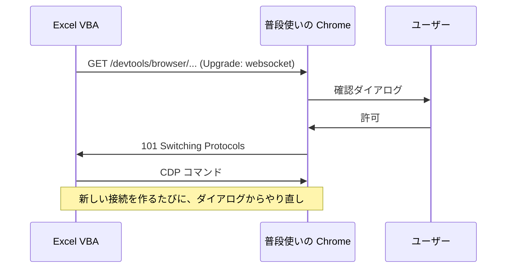
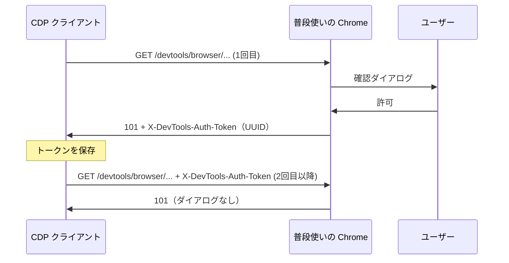

# 技術秘話: WebSocket 経路・その後

[技術秘話: WebSocket 経路](/stories/DebugRouteTech/websocket-tech)では、安定版の Chrome で確かめた接続フローを解説しています。

その後、`chrome://inspect/#remote-debugging` から起動する承認モードのまわりで、Chromium 側の改良が進み始めました。ただし、どれもまだ安定版には入っていません。そこで本編の接続フローは今の動作のまま残し、このページに、見つかった動きを日付順に足していきます。安定版に入って動作を確かめられたら、本編のほうを書き直す予定です。

::: info このページの読み方
* 日付は、筆者が確かめた日です。変更が作られた日・取り込まれた日は、それぞれの記録の中に書いています
* 「レビュー中」「作業中」の変更は、そのまま製品に入るとは限りません。状態が変わったら、新しい日付の記録で追いかけます
* 推測を書くときは、推測だと分かるように書いています
:::

## 今の承認モード（おさらい）

本編の内容を、このページで使う範囲だけまとめます。

* `chrome://inspect/#remote-debugging` で有効にすると、普段使いのブラウザがデバッグ用のサーバーを開き、ポートを `DevToolsActivePort` に書き出す
* ツールは、`Origin` を付けずに WebSocket のハンドシェイクを送る。`Host` は `127.0.0.1:<ポート>`
* ブラウザは、新しい WebSocket 接続のたびに確認ダイアログを出す。「許可」を押すと `101` が返り、そのまま CDP を送れる
* 受け付けるのはブラウザ全体（`/devtools/browser/...`）への接続だけ。`/json/*` には応答しない（`404`）
* このツールは、接続したソケットのハンドルを Excel のテーブルに記録して使い回すので、2回目以降の Sub ではダイアログが出ない

問題は最後の行です。接続をつなぎ直すたびにダイアログが出るので、ワンショットでコマンドを送るクライアントでは、何度も「許可」を押すことになります。本編で紹介した [chrome-devtools-mcp#1794](https://github.com/ChromeDevTools/chrome-devtools-mcp/issues/1794) の苦情は、これが原因でした。

## 2026年11月17日：トークン認証と、接続元の情報

### きっかけ

BiDi まわりの変更を追いかけていたときに、同じ `devtools_http_handler.cc` を触っているレビュー中の変更の一覧で、承認モードに関わるものがいくつも見つかりました。ここでは、それを「ダイアログを減らす変更」と「接続元を見分ける変更」の2つに分けて整理します。

| 日付 | 変更 | 中身 | 状態（2026-11-17） |
| --- | --- | --- | --- |
| 2026-03-19 | [7684633](https://chromium-review.googlesource.com/c/chromium/src/+/7684633)「Validate Host header in DevTools websocket requests.」 | WebSocket のハンドシェイクでも `Host` を確かめる。ローカル以外の `Host` には `500` を返す | 取り込み済み |
| 2026-09-18 | [8425439](https://chromium-review.googlesource.com/c/chromium/src/+/8425439)「DevTools: allow same-origin WebSocket connections to debugging server」 | `Origin` がサーバー自身のアドレス（`http://<IP>:<ポート>`）と同じなら、`--remote-allow-origins` に無くても受け付ける | 取り込み済み |
| 2026-10-21 | [8618244](https://chromium-review.googlesource.com/c/chromium/src/+/8618244)「Expose DevTools client PeerMetadata and delegate in TargetHandler」 | 接続してきたクライアントの情報（Pipe か WebSocket か、WebSocket の相手のアドレスとポート）を、ブラウザ側から読めるようにする | 取り込み済み |
| 2026-11-03 | [8714122](https://chromium-review.googlesource.com/c/chromium/src/+/8714122)「[DevTools] Issue and accept auth tokens for WebSocket approval mode」 | 承認したら `101` の応答でトークンを返し、次からはトークン付きの接続をダイアログなしで受け付ける | 作業中（Work In Progress） |
| 2026-11-11 | [8796132](https://chromium-review.googlesource.com/c/chromium/src/+/8796132)「Attribute tabs created via DevTools HTTP PUT /json/new」 | `/json/new` で作られたタブを、それを作った外部のクライアントに結びつけて記録する（企業向けの記録） | レビュー中 |
| 2026-11-13 | [Issue 585226722](https://issues.chromium.org/issues/585226722)「Show requesting client identity in the chrome://inspect/#remote-debugging approval dialog」 | 確認ダイアログに、接続してきたクライアントが誰かを表示してほしい、という要望 | 要望（New、P2）。変更はまだ無い |
| 2026-11-16 | [8799465](https://chromium-review.googlesource.com/c/chromium/src/+/8799465)・[8793969](https://chromium-review.googlesource.com/c/chromium/src/+/8793969) | CDP の `Target.createTarget` で作られたタブも、同じように記録する | 取り込み済み |

上の2行（`Host` と `Origin`）は、承認モード専用の変更ではありません。どちらもハンドシェイクの検査を変える変更なので、ここに並べています。このツールは `Host` に `127.0.0.1:<ポート>` を送り、`Origin` は送らないので、どちらの変更でも今の動作は変わりません。

### ダイアログを減らす：認証トークン（8714122）

いちばん大きいのが、この変更です。説明文によると、流れは次のようになります。

* 承認モードの `DevToolsHttpHandler` は、これまで WebSocket 接続のたびに確認ダイアログを出していた
* ダイアログで承認されたら、UUID のトークンを作って `DevToolsHttpHandler` に保存し、`101` の応答のヘッダー `X-DevTools-Auth-Token` で返す
* その後、`/devtools/browser` への WebSocket 接続のうち、正しい `X-DevTools-Auth-Token` をリクエストのヘッダーに付けたものは、ダイアログを出さずに受け付ける
* トークンは、`DevToolsHttpHandler` が動いている間ずっと有効。リモートデバッグを止めると `DevToolsHttpHandler` が破棄され、トークンもすべて無効になる
* ブラウザの JavaScript の `WebSocket` API はリクエストに独自のヘッダーを付けられないので、トークンを送れるのはネイティブの CDP クライアントだけ

そのために、`net::HttpServer::AcceptWebSocket` と `net::WebSocket::Accept` も手直しして、`101` の応答に任意のヘッダーを足せるようにしています。

本編の「確認ダイアログの仕様」で書いた、次の対比を思い出してください。

| | 2回目以降にダイアログを出さない方法 |
| --- | --- |
| 今 | 接続そのものを切らずに持ち続ける（このツールなら Excel 自身、ほかの言語ならデーモン） |
| トークン後 | 接続は切ってよい。トークンを持っておき、つなぎ直すときに見せる |

つまり、「接続を持ち続ける」代わりに「トークンを持ち続ける」ことになります。ワンショットのクライアントでも、トークンをファイルなどに保存しておけば、ダイアログは最初の1回で済みます。

ただし、[#1794](https://github.com/ChromeDevTools/chrome-devtools-mcp/issues/1794) で指摘されていた「接続を共有するデーモンは乗っ取りの危険がある」という問題は、形を変えて残ります。トークンを読めるプログラムなら、承認なしで接続できるからです。守る対象が「ソケットのハンドル」から「トークン」に移るだけで、セキュリティの境界がクライアント側に移るという点は、本編で書いたことと同じです。

なお、次の点は説明文に書かれておらず、分かっていません。

* 間違ったトークンを送ったときに、ダイアログに戻るのか、`403` などで断られるのか
* トークンを付けた接続にも、ブラウザ全体（`/devtools/browser/...`）以外への接続が許されるのか（説明文では `/devtools/browser` だけ）

この変更は 2026-11-03 にパッチセット4まで作られたあと、同じ日に作成者が「Work In Progress」に戻しています。11月17日の時点では、それ以降の更新はありません。

### 接続元を見分ける：PeerMetadata と、企業向けの記録

もう1つの流れは、「今つないできたのは誰か」をブラウザが知るための変更です。

土台になるのが、10月に取り込まれた 8618244 の `PeerMetadata` です。CDP のクライアントごとに、次の2つを持たせます。

| 項目 | 中身 |
| --- | --- |
| `transport_type` | Pipe か WebSocket か |
| `peer_address` | WebSocket の場合、相手のアドレスとポート |

さらに、`Target.attachToTarget` や `Target.setAutoAttach` でつないだ子のセッションにも、元のクライアントの情報を引き継ぎます。

11月16日には、この情報を使う変更（8799465、8793969）が取り込まれました。ファイルの場所は `chrome/browser/enterprise/connectors/reporting/` で、企業の管理者向けのセキュリティの記録（Chrome Enterprise のレポート）に使うものです。ヘッダーのコメントから読み取れる範囲では、次のことをします。

* 外部から Pipe や WebSocket で接続してきた CDP のクライアントについて、OS のプロセスの親子関係（最大16段）をたどる
  * Pipe なら、ブラウザの親プロセスから
  * WebSocket なら、相手のアドレスとポートからプロセスを割り出して、そこから
* CDP のコマンドで作られたタブを、そのクライアントに結びつけて記録する（`Target.createTarget` は 8793969、`/json/new` はレビュー中の 8796132）
* 対象は、Chrome Browser Cloud Management で管理されている端末の、通常のプロファイルだけ。機能のフラグ（`kEventReportingCdpAttribution`）が有効なときだけ動く

2026年11月17日の時点では、ビルドの設定 `enterprise_cdp_attribution` が `is_mac` になっていて、この機能が組み込まれるのは macOS だけです。WebSocket の相手のプロセスを割り出す処理も、macOS の `libproc` で書かれています。

このツールで言えば、ブラウザが「つないできたポートから Excel のプロセスを探す」ことになります。Windows に広がった場合、管理された端末では、タブを操作したのが `EXCEL.EXE` だと記録に残るようになる、と考えています（推測です）。

なお、`/json/new` は承認モードでは使えない（`404`）ので、8796132 が効くのは、`--remote-debugging-port` で起動したブラウザのほうです。

### ダイアログに接続元を表示する（Issue 585226722）

11月13日には、確認ダイアログそのものへの要望も出ています。

* 今の「Allow remote debugging?」のダイアログには、どのアプリ・エージェントが接続を求めているかが出ない。複数のエージェントを使っていると、どれを許可しているのか分からない
* 接続してきたクライアントが誰かを表示してほしい。クライアントが自分で名乗るラベルと、確かめられた情報は、区別して表示してほしい

11月15日のコメント #2 では、Chromium 側の担当者が、作るときの見通しを書いています。

* 表示する文言は `chrome/app/generated_resources.grd` に足す。その前に、`devtools_http_handler.cc` から呼ばれるコールバックを広げて、クライアントの名前を渡せるようにする
* ただし名前だけだと、どのエージェントでも好きな名前を名乗れてしまい、脆弱性になる。それを避けるために、IP・ポート・接続方式・`User-Agent` ヘッダーも表示に加えるべき

接続方式と相手のアドレス・ポートは、すでに `PeerMetadata` で取れるようになっています。足りないのは、ダイアログまで情報を渡す部分と、表示の部分です。11月17日の時点では、この Issue に紐づく変更（Code Changes）はまだありません。

### 今後の見込み

ここまでを並べると、承認モードは次のように変わっていくと考えています（推測を含みます）。

| 段階 | 接続の流れ | 状態（2026-11-17） |
| --- | --- | --- |
| 今（安定版） | 接続のたびにダイアログ → 許可 → `101` → CDP | 安定版の動作 |
| トークン | 初回だけダイアログ → `101` でトークンを受け取る → つなぎ直すときはトークンを付けて、ダイアログなしで `101` | 8714122 が作業中 |
| 接続元の表示 | ダイアログに、接続方式・アドレスとポート・`User-Agent` などが出る | 要望の段階。変更はまだ無い |
| 接続元の記録 | 管理された端末では、CDP で作ったタブとクライアントのプロセスが記録に残る | macOS だけ取り込み済み |

トークンと接続元の表示は、それぞれ別の Issue・変更で進んでいて、どちらが先に入るか、両方入るかは分かりません。

### このツールへの影響

どれも安定版に入っていないので、今のところ、このツールで直すところはありません。入った場合に関係しそうな点を書いておきます。

* トークン：`101` の応答のヘッダーから `X-DevTools-Auth-Token` を読み、保存しておき、つなぎ直すときのハンドシェイクに付ければ、2回目以降のダイアログを省ける。今の `ReadHandshakeResponse` は `101` かどうかしか見ていないので、ヘッダーを読む処理が要る
* トークン：今のハンドルの使い回し（`serialize` と `ReConnectCDP`）は、接続が生きている間しか使えない。トークンなら、接続が切れたあとも、リモートデバッグを止めるまでは使える。その代わり、トークンをどこに保存するかが、ハンドルと同じくセキュリティの境界になる
* 接続元の表示：ダイアログに `User-Agent` が出るようになったら、このツールはハンドシェイクで `User-Agent` を送っていないので、空のまま表示されるかもしれない（推測です）。送るなら、何と名乗るかを決める必要がある
* `Host` は今どおり `127.0.0.1:<ポート>` のまま。`Origin` も送らないままで問題ない

承認モードは、ツールが自分で起動したブラウザ（`--remote-debugging-port` と `--user-data-dir` を付けたもの）には関係しません。ここに書いた変更のうち、承認モードの外でも効くのは、`Host`・`Origin` の検査と、接続元の記録だけです。

### 考察：ダイアログで「どの接続か」を見分けるには

ここからは、Chromium の変更ではなく、筆者の考察です。2026年11月17日の時点で、Chromium 側にこうした案は出ていません。

#### 自己申告と、確かめられる情報

Issue 585226722 の起票者は、「確かめられた情報」と「クライアントが名乗るラベル」を区別して表示してほしい、と求めています。SNS の認証済みバッジに近い考え方です。今の Chromium で取れる情報を、この2つに分けると次のようになります。

| 情報 | どこから来るか | 今の Chromium |
| --- | --- | --- |
| 接続方式（Pipe か WebSocket か）・相手の IP とポート | ブラウザ自身が通信から取る（偽れない） | `PeerMetadata` で取れる。ダイアログには出していない |
| `User-Agent` やクライアントの名前 | クライアントの自己申告（好きに名乗れる） | ダイアログで使う処理は無い |
| 接続元のプロセス（実行ファイルのパス・起動時の引数） | OS に問い合わせる（偽りにくい） | 企業向けの記録でだけ取っている。macOS だけで、ダイアログには使っていない |

コメント #2 は `User-Agent` を偽られないための情報に並べていますが、`User-Agent` もクライアントの自己申告です。本当に偽れないのは、IP・ポート・接続方式の3つだけです。

プロセスの情報も、取っているのは実行ファイルのパスと引数（`node` などのインタープリターなら、スクリプトのパスも）までです。コード署名（発行元）は確かめていません。Windows と Linux への対応も、コードに TODO（crbug.com/575478024）として残っているだけです。「ローカルの `EXCEL.EXE` から WebSocket でつないできた」くらいまでは表示できそうですが、「署名を確かめた認証済みのクライアント」を判断する処理は、まだ構想にも出てきていません（推測を含みます）。

#### 今できること：事前の申告と、タイミング

今のダイアログには、接続元の情報が何も出ません。そのため、今できる照合は「これからつなぐので、今出たダイアログを許可してください」と前もって伝え、時間で突き合わせることだけです。AI のエージェントが利用者にそう伝えてから接続する、という形になります。

人間が目で確かめる手間は残ります。それに、同じ瞬間に別のプログラムが接続してきたら区別できません。ただ、普段使いの PC でそれが起きることはまずないので、実用上は十分だと考えています。

#### 自分のポートは、ハンドシェイクの前に分かる

相手側のポート（クライアントの送信元のポート）は、OS が接続のときに割り当てるので、本来は前もって分かりません。ただし、確認ダイアログが出るのは WebSocket のハンドシェイクを受け取ったときで、TCP がつながっただけでは出ません。そこで、次の順にすれば、ダイアログが出る前に自分のポートを伝えられます。

1. `connect` で TCP をつなぐ（この時点では、ダイアログは出ない）
2. `getsockname` で自分のポートを調べ、「21891 番のポートから接続します」と表示する
3. ハンドシェイクを送る（ここでダイアログが出る）

VBA でも、WinSock の `getsockname` を `Declare` すれば同じことができます。将来、ダイアログに相手のポートが表示されるようになれば、この表示とダイアログを突き合わせて照合できます。

#### ペアリング番号という案

もう一歩進めるなら、Bluetooth のペアリングで「両方の画面の数字が同じか確かめる」方式（Numeric Comparison）を、この確認ダイアログに持ち込む方法が考えられます。

1. クライアントがランダムな番号を作る（例: `482913`）
2. クライアントが自分の画面やログに「ペアリング番号: 482913」と出す
3. ハンドシェイクのヘッダーで番号を送る（例: `X-DevTools-Pairing-Code: 482913`。ヘッダーの名前は仮のもの）
4. ダイアログにも `482913` と出る
5. 利用者が2つを見比べて、一致していれば許可する

番号はクライアントが決めるので、これ自体は自己申告です。それでも、割り込んでくる別のプログラムは、正しいクライアントが画面に出している番号を知りません。同じ瞬間に2つの接続が来ても、番号が合うのは本物だけです。名前やバッジのように「誰か」を証明するのではなく、「どの要求か」を取り違えないための仕組みで、タイミングでしか照合できないという弱点を埋められます。

Bluetooth との違いもあります。Bluetooth の数字は、両方の機器の鍵の交換の結果から計算されるので、間に入った第三者には同じ数字を作れません。こちらはクライアントが自由に決めた番号なので、そこまでの強さはありません。考え方としては、GitHub CLI やテレビでのログインで使われる「デバイスコード」（画面に出たコードを、別の画面で照合する）のほうが近いです。

今の流れにも、無理なく足せます。

* Issue 585226722 の起票者が求めている「クライアントが付けられる任意のラベル」に、ほぼそのまま収まる
* ブラウザの JavaScript の `WebSocket` API は独自のヘッダーを送れないので、トークンと同じく、ネイティブのクライアントに限られる。もともとネイティブのクライアント向けの機能なので、問題にならない
* このツールなら、ハンドシェイクに1行足して、番号を `MsgBox` や `Debug.Print` で出すだけで済む

#### この照合で守れる範囲

ペアリング番号を盗まれる経路としては、次の2つが考えられます。どちらも、それができる時点で別の意味で手遅れです。

* ローカルの通信（127.0.0.1）の盗み見：Windows でループバックの通信を取るには、Npcap のような専用のドライバーが要り、入れるには管理者権限が要る。そこまでできるプログラムなら、番号を盗むより直接的なことができる
* メモリの覗き見：同じユーザーで動いているプロセスなら、管理者権限が無くても、`OpenProcess` と `ReadProcessMemory` でたいてい読めてしまう。ただし、そうしたプログラムは、`DevToolsActivePort` を読んで自分で接続することも、Excel のテーブルに記録したソケットのハンドルや将来のトークンを読むことも、ブラウザのプロファイルにある Cookie などを読むこともできる

つまり、ペアリング番号で防げるのは、同じ PC で普通に動いている別のクライアントとの取り違えや、同時に来た接続の混同までです。マルウェアまで防ぐものではありません。Bluetooth の Numeric Comparison も、守っているのは2台の機器のあいだの通信で、機器そのものが乗っ取られていれば無力です。

それでも、ペアリング番号は接続が成立したあとには使わない、使い捨ての値です。承認済みの状態をずっと表すトークンやハンドルと比べると、盗まれたときの危険は小さく済みます。[#1794](https://github.com/ChromeDevTools/chrome-devtools-mcp/issues/1794) の回答が懸念していた「承認済みの何かを、ほかのプロセスから見える場所に置く」問題も、番号には当てはまりません。

結局、自己申告を信じるかどうかを決めるのは、人間の目です。照合に使える手がかり（タイミング、ポート、番号）をどれだけ増やせるかが、この確認ダイアログを使いやすくする鍵だと考えています。

### 参考資料

* Chromium の変更（作業中）: [8714122](https://chromium-review.googlesource.com/c/chromium/src/+/8714122)「[DevTools] Issue and accept auth tokens for WebSocket approval mode」（2026-11-03 作成）
* Chromium の変更（取り込み済み）: [8618244](https://chromium-review.googlesource.com/c/chromium/src/+/8618244)「Expose DevTools client PeerMetadata and delegate in TargetHandler」（2026-10-21）
* Chromium の変更（取り込み済み）: [8799465](https://chromium-review.googlesource.com/c/chromium/src/+/8799465)「Support browser-level CDP and HTTP target creation in CdpActorSessionTracker」（2026-11-16）
* Chromium の変更（取り込み済み）: [8793969](https://chromium-review.googlesource.com/c/chromium/src/+/8793969)「Wire browser-level CDP Target.createTarget attribution in DevTools」（2026-11-16）
* Chromium の変更（レビュー中）: [8796132](https://chromium-review.googlesource.com/c/chromium/src/+/8796132)「Attribute tabs created via DevTools HTTP PUT /json/new」（2026-11-11 作成）
* Chromium の変更（取り込み済み）: [8425439](https://chromium-review.googlesource.com/c/chromium/src/+/8425439)「DevTools: allow same-origin WebSocket connections to debugging server」（2026-09-18）
* Chromium の変更（取り込み済み）: [7684633](https://chromium-review.googlesource.com/c/chromium/src/+/7684633)「Validate Host header in DevTools websocket requests.」（2026-03-19）
* Chromium の Issue: [585226722](https://issues.chromium.org/issues/585226722)「[Remote Debugging] Show requesting client identity in the chrome://inspect/#remote-debugging approval dialog」（2026-11-13 作成）
* Chromium（2026-11-17 時点の main）: [cdp\_actor\_session\_tracker.h](https://source.chromium.org/chromium/chromium/src/+/main:chrome/browser/enterprise/connectors/reporting/cdp_actor_session_tracker.h)、[process\_extractor.h](https://source.chromium.org/chromium/chromium/src/+/main:components/enterprise/connectors/core/process_extractor.h)、[buildflags.gni](https://source.chromium.org/chromium/chromium/src/+/main:components/enterprise/buildflags/buildflags.gni)（`enterprise_cdp_attribution = is_mac`）
* [chrome-devtools-mcp#1794](https://github.com/ChromeDevTools/chrome-devtools-mcp/issues/1794)（確認ダイアログが重なって出る件。2026年10月に not planned で終了）
* [getsockname 関数 (winsock.h)](https://learn.microsoft.com/ja-jp/windows/win32/api/winsock/nf-winsock-getsockname)（つないだソケットの、自分側のアドレスとポートを調べる）

## 次に読む

- [技術秘話: WebSocket 経路](/stories/DebugRouteTech/websocket-tech) — 本編。安定版での接続フローと、確認ダイアログの仕様
- [BiDi 登場秘話・その後](/stories/DevHistory/bidi-story2) — 同じ時期に見つかった、BiDi まわりの動き
