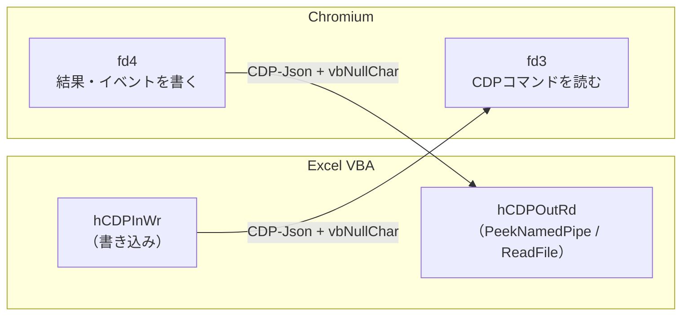

# 技術秘話: Pipe 経路

[開発秘話](/stories/birth-story)のページにある話のうち、技術的な内容だけを切り出した資料です。

現代のブラウザ、ここでは Chromium（Edge、Chrome）を外部から制御する方法は、大きく分けて2つあります。

- `remote-debugging-pipe`
  - fd3/4 に匿名パイプをつなぎ、そこで CDP をやり取りする
- `remote-debugging-port`
  - WebSocket のルールに従って CDP をやり取りする

このツールは、まず `remote-debugging-pipe` から攻略しました。参考にした本家ライブラリがこの方式だったから、という理由もあります。

## `remote-debugging-pipe`

`remote-debugging-pipe` の決まりは非常に単純で、次の2つだけです。

- `vbNullChar` 1文字がメッセージの終端の目印
- fd3/4 で送受信する

1つ目はなんとなく分かると思いますが、fd3/4 は何のことか分かりませんよね。
これを説明する前に、まず一般的なパイプの仕様をお伝えします。

VBA で少し高度なことをすると、`CreateObject("WScript.Shell").Exec` を見かけると思います。この `Exec` で起動したプロセスとは、次の3つでやり取りします。

| `Exec` のプロパティ | 意味 |
| --- | --- |
| `StdOut` | 標準出力 |
| `StdErr` | 標準エラー出力 |
| `StdIn` | 標準入力 |

すると、自然とこう考えるわけです。

| `Exec` のプロパティ | CDP での役割（予想） |
| --- | --- |
| `StdOut` | CDP からの結果メッセージ |
| `StdErr` | ブラウザ自体のエラー |
| `StdIn` | CDP コマンドの送信 |

でも、実際は違いました。それが「fd3/4 で送受信」です。

### fd（ファイルディスクリプタ）とは

fd（File Descriptor）は、プロセスが開いている入出力先に振られた番号です。0〜2 は、さきほどの3つに予約されています。

| fd | 名前 | `Exec` のプロパティ |
| --- | --- | --- |
| 0 | 標準入力 | `StdIn` |
| 1 | 標準出力 | `StdOut` |
| 2 | 標準エラー出力 | `StdErr` |
| 3 | （予約なし） | なし |
| 4 | （予約なし） | なし |

3 以降は予約されておらず、追加で開いたファイルやパイプに割り当てられます。`--remote-debugging-pipe` を付けて起動した Chromium は、次の決まりで動きます。

- **fd3** から CDP コマンドを読み取る
- **fd4** へ CDP の結果やイベントを書き込む

最初の予想に当てはめると、`StdIn` の役は fd3、`StdOut` の役は fd4 が担っていたことになります。

### Chromium のソースで確かめる

この決まりは、Chromium のソースにそのまま書かれています。番号は定数として固定されています。

```cpp
// content/public/browser/devtools_agent_host.h
static constexpr int kReadFD = 3;
static constexpr int kWriteFD = 4;
```

起動引数の定義（`content/public/common/content_switches.cc`）では、`remote-debugging-pipe` を「stdio pipes [in=3, out=4]」で remote debugging を有効にする引数と説明しています。メッセージの形式は既定が JSON で、`--remote-debugging-pipe=cbor` とするとバイナリ形式（CBOR）も選べます。

終端の目印も、パイプを扱う `content/browser/devtools/devtools_pipe_handler.cc` で確かめられます。

- 送信するとき：メッセージの後ろに `\0` を1バイト書き足す
- 受信するとき：読み込んだデータから `\0` を探し、そこで1件のメッセージとして切り出す

VBA の `vbNullChar` は、この `\0` にあたります。

### なぜ標準入出力を使わないのか

Chromium のソースにも、この方式を追加したときのレビューにも、標準入出力を避けた理由は書かれていません。確かめられる事実は次のとおりです。

- 起動引数の説明では、fd3/4 を「stdio pipes」と呼んでいる
- Puppeteer の `pipe` オプションの説明は「2つの追加ストリームを開く」で、起動時に fd0〜4 の5本を用意している
- Puppeteer の `dumpio` オプションは、ブラウザの標準出力と標準エラー出力を、CDP とは別に Node.js 側へ流す

ここから、fd0〜2 は通常の標準入出力のまま残し、CDP 専用の通り道として fd3/4 を**追加した**設計と読み取れます。

::: info 導入の経緯
`devtools_pipe_handler.cc` の著作権表記は 2017 年です。2018年3月には Headless 版 Chromium にも `--remote-debugging-pipe` への対応が入り、同年4月3日に Puppeteer の `pipe` オプションがマージされました。
:::

### Windows で fd3/4 を渡すには

ここでもう1つ問題があります。fd は、もともと C 言語のランタイム（CRT）の仕組みです。Windows の OS 自体が扱うのはハンドルで、`CreateProcess` の `STARTUPINFO` で子プロセスへ直接渡せるのは、`hStdInput` / `hStdOutput` / `hStdError` の3つだけです。`WScript.Shell.Exec` が `StdIn` / `StdOut` / `StdErr` しか持たないのも、同じ事情です。そのため、`Exec` では fd3/4 を用意できません。

そこで使うのが、`STARTUPINFO` の `lpReserved2` です。CRT で作られたプログラムは起動時に `lpReserved2` を読み、そこに書かれたハンドルを fd0、fd1、fd2、fd3…として登録し直します。Chromium 側は、`_get_osfhandle(3)` / `_get_osfhandle(4)` で、fd3/4 に登録されたハンドルを取り出して使います。

`lpReserved2` には、次の形のデータを渡します。

```
[ fdの数 ][ fd0〜fd4 のフラグ ][ fd0〜fd4 のハンドル ]
  4バイト    1バイト × 5          8バイト × 5（32bit版は4バイト × 5）
```

- フラグの値 `9` は、`FOPEN`（1）と `FPIPE`（8）の組み合わせで、「開いているパイプ」を表します
- フラグとハンドルは、隙間なく詰めて並べる必要があります。VBA の `Type` では、`Byte` の後ろに `LongPtr` を置くと隙間が入ってしまいます。そのため、このツールではハンドルを1バイトずつバイト配列へ詰めています（`CDPCore.InitCDP`）

::: warning fd3/4 を渡し忘れると
fd の番号は固定なので、親プロセスがパイプを渡さないと、Chromium がたまたま fd3/4 として開いた別のファイルを読み書きしてしまうおそれがありました。2023年の修正（crbug.com/1423048）で、起動のごく早い段階で fd3/4 が開いているかを確かめるようになっています。
:::

### もう1つの渡し方：`--remote-debugging-io-pipes`

Windows 版の Chromium には、`lpReserved2` を使わない渡し方もあります。`--remote-debugging-io-pipes=<入力>,<出力>` のように、パイプのハンドル値を符号なし整数にして、カンマ区切りで渡す方法です。1つ目が Chromium の読み取り用、2つ目が書き込み用です。Chromium は、渡された値がパイプのハンドルかを確かめてから fd に登録します。

ハンドル値はプロセスごとの番号なので、この方法でもハンドルは子プロセスへ継承させる必要があります。このツールは、現在 `lpReserved2` の方法を使っています。

### VBA 側で用意しているパイプ

`CreatePipe` で作るパイプは1本ごとに「読む側」と「書く側」の端を持ちます。片方を Chromium に渡し、もう片方を VBA が持ちます。

| fd | 用途 | Chromium に渡す端 | VBA が持つ端 |
| --- | --- | --- | --- |
| 0 | 標準入力 | `hStdInRd` | `hStdInWr` |
| 1 | 標準出力 | `hStdOutWr` | `hStdOutRd` |
| 2 | 標準エラー出力 | `hStderrOutWr` | `hStderrOutRd` |
| 3 | CDP コマンド | `hCDPInRd` | `hCDPInWr` |
| 4 | CDP の結果・イベント | `hCDPOutWr` | `hCDPOutRd` |



VBA は `hCDPInWr` へ CDP コマンドを書き込み、`hCDPOutRd` から結果を読み取ります。`StdOut` / `StdErr` に当たるパイプも用意していますが、CDP のやり取りには使いません。

::: tip Chromium 側のバッファ
`devtools_pipe_handler.cc` では、受信バッファの上限を 100MB、送信を 64KB 単位と定めています。
:::

なお、標準出力と標準エラー出力のパイプは、Chromium 系ではあまり意味がありません。ただ、Electron などにつないでのぞいてみると、生々しいログが見られるなど面白いことが起こります。それはまた別のお話…。

そして、このツールの VBA でも、さきほどの `vbNullChar` 区切りを目印に、受信したデータからうまく1件ずつメッセージを取り出しています。取り出したメッセージは `RaiseEvent` で各クラスへイベントとして発信され、各クラスで処理されます。発信するイベントは4種類あります。それぞれの役割は、[イベント処理と拡張性](/vba-comparison/events)の「`RaiseEvent` 4種」の節で詳しく説明しています。

## 参考資料

- [content/public/browser/devtools_agent_host.h](https://source.chromium.org/chromium/chromium/src/+/main:content/public/browser/devtools_agent_host.h)（`kReadFD` / `kWriteFD`）
- [content/public/common/content_switches.cc](https://source.chromium.org/chromium/chromium/src/+/main:content/public/common/content_switches.cc)（`remote-debugging-pipe` / `remote-debugging-io-pipes`）
- [content/browser/devtools/devtools_pipe_handler.cc](https://source.chromium.org/chromium/chromium/src/+/main:content/browser/devtools/devtools_pipe_handler.cc)（`\0` 区切り、CBOR、バッファ）
- [content/browser/devtools/devtools_agent_host_impl.cc](https://source.chromium.org/chromium/chromium/src/+/main:content/browser/devtools/devtools_agent_host_impl.cc)（`--remote-debugging-io-pipes` の受け取り）
- [[DevTools] Check FDs are open for --remote-debugging-pipe mode](https://groups.google.com/a/chromium.org/g/devtools-reviews/c/iJ4sHeAMiu4)（2023年、crbug.com/1423048）
- [Headless: Add support for the --remote-debugging-pipe flag](https://groups.google.com/a/chromium.org/g/devtools-reviews/c/wnCpqPbWqiU)（2018年）
- [puppeteer/puppeteer#2288 feat(Launcher): connect over a pipe](https://github.com/puppeteer/puppeteer/pull/2288)
- [Puppeteer launch.ts](https://github.com/puppeteer/puppeteer/blob/main/packages/browsers/src/launch.ts)（`pipe` / `dumpio`）
