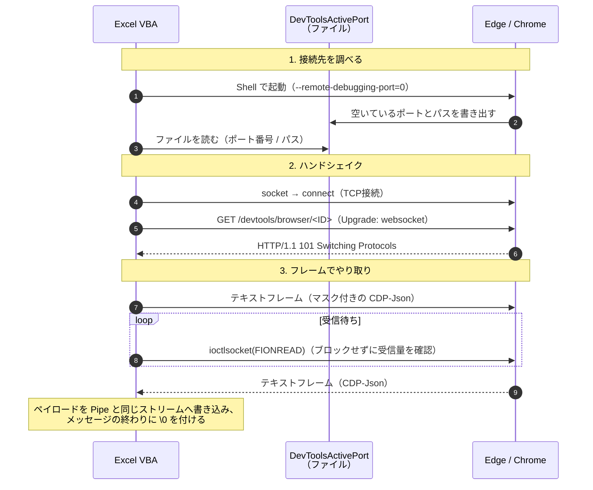

# 技術秘話: WebSocket 経路

ここでは、`remote-debugging-port` についてお伝えします。

[設計思想](/websocket/design)のページにある通り、当初は `remote-debugging-pipe` だけにとどめようとしていました。
しかし、`remote-debugging-pipe` だけでは[実現できない機能](/websocket/capabilities)があると分かり、実装するに至りました。

最初は、`winhttp.dll` の WebSocket API で試みました。しかし、どちらのモードにも問題がありました。

- 同期モード：届いたメッセージがないと、Excel がフリーズする
- 非同期モード：コールバックの対策をなんとかしないと、Excel ごとクラッシュする

どちらに進んでも詰みでした。`WebSocket` ブランチで色々と格闘しましたが、最終的には WinSock で一から作りました。

というのも私、ある勘違いをしていました。

- ×：WebSocket という専用のパイプがある。だから `winhttp.dll` の WebSocket API を使うものだと思い込んでいた
- 〇：Pipe にネットワーク機能を足し、その上に決めた単なるメッセージのルールに過ぎない

分かってしまえば単純な話です。VBA 自身が WebSocket を話せるロジックを組めばいいんだ、と。

## 接続フロー

WebSocket での接続は、次の3段階に分かれます。

1. 接続先（ポート番号とパス）を調べる
2. TCP で接続し、HTTP から WebSocket へ切り替える（ハンドシェイク）
3. WebSocket のフレームで CDP をやり取りする



### 1. 接続先を調べる

接続先の URL は、`ws://127.0.0.1:<ポート>/devtools/browser/<ID>` の形をしています。このツールの調べ方は、場面によって2通りです。

| 場面 | 調べ方 | 主な実装 |
| --- | --- | --- |
| VBA からブラウザを起動する | `DevToolsActivePort` ファイルを読む | `CDPCoreViaWebSocket.OpenBrowserAndConnectCDP` |
| 起動済みのブラウザにつなぐ | HTTP で `/json/version` か `/json/list` に問い合わせる | `AutoConnectBrowserCDP` / `AutoConnectPageCDP` |

#### `DevToolsActivePort` ファイル

`--remote-debugging-port=0` で起動すると、Chromium は空いているポートで待ち受けます。そして、そのポート番号とブラウザのパスを、ユーザーデータフォルダ直下の `DevToolsActivePort` ファイルに2行で書き出します。

```
53241
/devtools/browser/xxxxxxxx-xxxx-xxxx-xxxx-xxxxxxxxxxxx
```

この形式は、Chromium の `content/browser/devtools/devtools_http_handler.cc` で、ポート番号と改行とブラウザのパスを並べて書き出す処理として確かめられます。

このツールでは、次の順で接続先を手に入れます（`CDPHost.cls`）。

1. 前回の `DevToolsActivePort` ファイルを消す
2. `Shell` でブラウザを起動する。Pipe と違って fd3/4 を渡す必要がないので、`CreateProcess` ではなく `Shell` で足ります
3. ファイルが現れるまで待つ（0.1秒間隔で最大100回）
4. 中身を `vbLf` で分け、1行目をポート番号、2行目をパスとして使う

#### `/json/version` と `/json/list`

起動済みのブラウザには、HTTP で問い合わせます。問い合わせには、おまけ機能の WinHTTP ラッパー（`WebClient`）を使っています。

- `/json/version`：ブラウザ全体の情報。`webSocketDebuggerUrl` の末尾の ID を取り出し、`/devtools/browser/<ID>` に接続する
- `/json/list`：タブの一覧。URL やタイトルから目的のタブを選び、そのタブに接続する

### 2. ハンドシェイク

接続先が分かったら、WinSock の `socket` と `connect` で TCP 接続し、次の HTTP リクエストを送ります（`SendHandshake`）。

```http
GET /devtools/browser/<ID> HTTP/1.1
Host: 127.0.0.1:<ポート>
Upgrade: websocket
Connection: Upgrade
Sec-WebSocket-Key: dGhlIHNhbXBsZSBub25jZQ==
Sec-WebSocket-Version: 13
```

返事に `HTTP/1.1 101` が含まれていれば、ハンドシェイクは成功です（`ReadHandshakeResponse`）。ここから先、同じ TCP 接続の上で WebSocket のフレームをやり取りします。

- `Sec-WebSocket-Key` は、RFC 6455 に例として載っている値で固定しています。ローカルでの運用を想定しているためで、応答の `Sec-WebSocket-Accept` は検証せず、`101` だけを確かめています
- Chromium 側は、`Host` ヘッダーが IP アドレスか `localhost` でないと応答しません。また、`Origin` ヘッダーが付いている場合は、`--remote-allow-origins` で許可された接続元しか受け付けません。このツールは `Origin` を送らないので、このチェックには掛かりません

### 3. フレームでやり取りする

WebSocket では、1件のメッセージの前にフレームヘッダーを付けて送ります（RFC 6455）。

| 位置 | 中身 |
| --- | --- |
| 1バイト目 | FIN（メッセージの最後か）と opcode（`0x1` テキスト、`0x8` 切断など） |
| 2バイト目 | MASK（マスクの有無）と長さ（7ビット） |
| 続く2 / 8バイト | 長さが 126 なら2バイト、127 なら8バイトで実際の長さを書く |
| 続く4バイト | マスクキー（クライアントからサーバーへ送るときだけ） |
| 残り | ペイロード（CDP-Json） |

送信では、CDP-Json を UTF-8 に変換し、テキストフレーム（`0x1`）として組み立てます（`BuildFrame`）。クライアントからサーバーへのフレームはマスクが必須なので、4バイトのランダムなマスクキーとの XOR でペイロードを変換してから送ります。

受信では、まず `ioctlsocket(FIONREAD)` で、今どれだけのデータが届いているかを確かめます（`GetAsyncMessage`）。Pipe 版の `PeekNamedPipe` にあたる機能で、`winhttp.dll` の WebSocket API には、この「のぞき見」がありませんでした。データが届いていればヘッダーを解析し、ペイロードを取り出します。opcode が `0x8` なら切断要求なので、接続を閉じます。

### Pipe と同じ形にそろえる

取り出したペイロードは、Pipe 版と同じ受信ストリームに書き込みます（`CDPCore` の `viaWebSocket_readWebSocketCDP`）。そしてメッセージの最後（FIN）のフレームでは、Pipe と同じ終端の目印 `\0` を付け足します。

こうすることで、ここから先は [Pipe 経路](/stories/pipe-tech) とまったく同じ処理になります。`\0` 区切りで1件ずつ取り出し、`RaiseEvent` で各クラスへ発信します。

Pipe 経路のメッセージの捌き方は、私が丹精込めて作り上げた、自信のあるものです。メッセージの切り出しと、バッファー／カーソルの管理を組み合わせています。

実際のメッセージと終端の目印さえ流し込めれば、裏で WebSocket のフレームを解析していても、`CDPCore` から見れば、届くのは CDP のメッセージと終端の目印だけです。そのため、WebSocket 用にバッファー管理を追加する必要はありませんでした。

通信経路をすっきり追加できたのは、この `RaiseEvent` のおかげです。`CDPCoreViaWebSocket` は、取り出したペイロードを `readWebSocketCDP` イベントで `CDPCore` へ渡しているだけです。

## `DevToolsActivePort` ファイルについて

実装当初、このファイルの役目は次の1つでした。

- `--remote-debugging-port=0` を付けて起動すると、Chromium が空いているポートを見つけて、結果をこのファイルに書き出す。ツールはその情報をもとに WebSocket で接続し、CDP を始める

しかし最近では、次の役目にも使われています。

- 普段使いの、今起動しているブラウザ（`User Data`）への [CDP 制御](https://developer.chrome.com/blog/chrome-devtools-mcp-debug-your-browser-session?hl=ja)

Chrome チームのブログでは、この機能を AI エージェント向け、つまり MCP（Chrome DevTools MCP）から使うためのものとして紹介しています。

しかし、技術を読み解くと非常にシンプルで、既存の仕組みの使い回しでした。このツールの「`DevToolsActivePort` を読んで接続する」流れから見れば、接続フローはまったく同じで、違いは確認ダイアログがあるかないかだけです。許可すれば CDP で制御でき、拒否すれば `403` が返って、VBA がエラーで止まります。

### Chromium の履歴で確かめる

| 時期 | 出来事 | 根拠 |
| --- | --- | --- |
| 2018年5月 | ChromeDriver が、`--remote-debugging-port=0` で起動したブラウザのポートを `DevToolsActivePort` から読むようになる。ファイル自体は、この時点ですでにある | [ChromeDriver の CL](https://groups.google.com/a/chromium.org/g/devtools-reviews/c/5OGQTJJAGtc) |
| 2025年（Chrome 136） | 既定の `User Data` に対しては、`--remote-debugging-port` / `--remote-debugging-pipe` が無視されるようになる | [Chrome のブログ](https://developer.chrome.com/blog/remote-debugging-port?hl=ja) |
| 2025年11月19日 | WebSocket 接続のたびに承認を求める「approval-only」モードが、Chromium に追加される | [7c12e9d](https://github.com/chromium/chromium/commit/7c12e9df31863f0fe7a71411f54824f8339403c0) |
| 2025年11月24日 | `chrome://inspect` から、このモードでデバッグサーバーを起動できるようになる | [2e576ad](https://github.com/chromium/chromium/commit/2e576ad6c7ba4b9becbf873cf29b614ffc51f54d) |
| 2025年11月27日 | このモードでは、ユーザーデータフォルダの `DevToolsActivePort` から前回のポートを読んで再利用する。ファイルがなければ `9222` を使う | [cec7af2](https://github.com/chromium/chromium/commit/cec7af242a1ec8b33becd04582467cddb2902a26) |
| 2025年12月11日 | Chrome のブログで、Chrome 144 以降の機能として紹介される | [Chrome のブログ](https://developer.chrome.com/blog/chrome-devtools-mcp-debug-your-browser-session?hl=ja) |

承認制のモードには、通常の `--remote-debugging-port` と比べて次の違いがあります（`content/browser/devtools/devtools_http_handler.cc`）。

- `/json/version` や `/json/list` などの HTTP エンドポイントには応答しません（`404`）。そのため、接続先は `DevToolsActivePort` から調べる必要があります。このツールでは、`AutoConnectDevToolsActivePort` がこの流れにあたります
- 受け付けるのは、ブラウザ全体（`/devtools/browser/...`）への接続だけです。タブ（`/devtools/page/...`）へ直接つなごうとすると `403` が返ります
- 承認は接続のたびに求められます。ダイアログに応答するまでハンドシェイクの返事は届かず、このツールの `ReadHandshakeResponse` はその返事を待ち続けます

…気付きましたか？
「あれ、確か[起動済みの IE を制御する](https://kouten0430.hatenablog.com/entry/2018/08/11/150052)方法があったような…」

そうです。`CreateObject("Shell.Application")` のウィンドウを `For Each` で回し、名前やタイトルが一致したものを泥臭く操作する、約8年前（2018年）の記事です。

まさかここでも、昔できたことが今また、しかも公式の機能として復活してしまいました。

いつになっても、やっぱり便利さは求めたくなるものですね。

## 確認ダイアログの仕様

一般的なプログラミング言語（CLI）から見ると、次のようにワンショットでコマンドを送る方式になります。

- コマンド実行 → エージェントが普段使いのブラウザに接続 → 確認ダイアログが出る → 許可して所定の CDP コマンドを送る → 終わり
- コマンド実行 → エージェントが普段使いのブラウザに接続 → 確認ダイアログが出る → 許可して所定の CDP コマンドを送る → 終わり
- コマンド実行 → エージェントが普段使いのブラウザに接続 → 確認ダイアログが出る → 許可して所定の CDP コマンドを送る → 終わり
- …

AI チャットとしては1回分のやり取りのはずなのに、内部ではこのワンショットが何度も起きてしまいます。そのため、[こうした苦情](https://github.com/ChromeDevTools/chrome-devtools-mcp/issues/1794)も出ていました。要するに「確認ダイアログが多すぎてうっとうしい」という声です。

- UI Automation で自動承認する？
- 拡張機能で妥協する？

でも、実際の仕様はとても単純でした。

- 新しく WebSocket 接続が発生すると、確認ダイアログが出る

Chromium のソースでも、確認ダイアログを出すのは、新しい WebSocket 接続の要求を受けたとき（`devtools_http_handler.cc` の `OnWebSocketRequest`）だけです。承認の結果は覚えておらず、新しい接続のたびにダイアログ（`DevToolsConnectionDialog`）を出します。一方、承認済みの接続で届く CDP コマンドには、改めて承認を求めません。

なら、答えはシンプルです。`End Sub` しても、接続を維持すればいいのです。

…これ、立場によって難しさに結構な差があります。

- 一般的な CLI の言語：デーモンというものを、わざわざ別に作らないといけない
- VBA：Excel 自身がデーモンになる

VBA では、よくこう、うるさく言われていませんでしたか？

- `End Sub` の前に、`Nothing` しろ

当初はなんとなくの意味で受け止めていましたが、ようやく真意が分かりました。Excel 自身がデーモンなので、`Nothing` や `Close○○` をしないと、どんどんメモリが残り続けて、いつかクラッシュする…と。

そう、これはその性質を逆手に取ったものです。よく考えてみると、次のような違いになります。

| | 流れ |
| --- | --- |
| 一般的な CLI | CDP コマンドを送る → A ミリ秒 Sleep → 次の CDP コマンドを送る → `exit 0` → WebSocket 切断 |
| Excel | CDP コマンドを送る → `End Sub`（切断の命令は出していないので、内部ではつなぎっぱなし）→ A ミリ秒、何もしない → 次の Sub で CDP コマンドを送る → WebSocket 切断 → `End Sub` |

受け手のブラウザから見れば、「お、A ミリ秒何もなかったけど、同じ接続から次の CDP が来たな」というだけで、見分けがつきません。

このツールでは、接続したソケットのハンドルを Excel のテーブルに記録しています（`CDPCoreViaWebSocket` の `serialize`）。次の Sub では `ReConnectCDP` でそのハンドルを読み戻すので、ハンドシェイクをやり直さず、確認ダイアログも出ません。

::: warning `WSACleanup` について
`CDPCoreViaWebSocket` は、`Class_Initialize` で `WSAStartup` を呼び、`Class_Terminate` で `WSACleanup` を呼んでいます。`closesocket` は呼ばないので、`End Sub` でオブジェクトが破棄されても、ソケットを自分から閉じることはありません。

ただし、[Microsoft のドキュメント](https://learn.microsoft.com/ja-jp/windows/win32/api/winsock/nf-winsock-wsacleanup)では、`WSACleanup` を次のように説明しています。

- `WSAStartup` が成功した回数だけ `WSACleanup` を呼ぶ必要があり、実際に後始末をするのは最後の1回だけ。それより前の呼び出しは、内部の参照カウントを減らすだけ
- 実際に後始末をするときは、開いているソケットも `closesocket` を呼んだときと同じように閉じられる

それでも接続が残っているのは、Excel 自身も内部で WinSock を使っていて、この `WSACleanup` が最後の1回にならないからだと考えています。古いバージョンの Excel など、Excel 側が WinSock を使っていない環境では、`End Sub` の時点で接続が切れ、この方法が効かない可能性があります。本作者は、古い Excel を持っていないため、ここは推測となります。
:::

…しかしこれは同時に、セキュリティの境界がそのデーモンに移ることを意味します。このツールで言えば、同じ Excel のプロセスで動くマクロなら、記録されたハンドルを使って、承認なしでこの接続に CDP を送れます。

実際、[ダイアログの Issue](https://github.com/ChromeDevTools/chrome-devtools-mcp/issues/1794) では、ダイアログは WebSocket 接続ごとに出す設計で、接続を共有するデーモンは乗っ取りの危険がある、という回答でした。この Issue は 2026年10月に「not planned」で閉じられ、複数のクライアントでの利用は、[別の Issue](https://github.com/ChromeDevTools/chrome-devtools-mcp/issues/2188) で議論が続いています。この結論がどうなっていくか、私としては見ものです。

## 参考資料

- [content/browser/devtools/devtools_http_handler.cc](https://source.chromium.org/chromium/chromium/src/+/main:content/browser/devtools/devtools_http_handler.cc)（`DevToolsActivePort`、`/json/*`、`Host` と `Origin` のチェック）
- [Let your Coding Agent debug your browser session with Chrome DevTools MCP](https://developer.chrome.com/blog/chrome-devtools-mcp-debug-your-browser-session?hl=ja)（2025年12月、Chrome 144 以降）
- [Implement DevTools remote debugging approval mode](https://github.com/chromium/chromium/commit/2e576ad6c7ba4b9becbf873cf29b614ffc51f54d)（2025年11月、crbug.com/460665929）
- [[ChromeDriver] Prevent collision of --remote-debugging-port](https://groups.google.com/a/chromium.org/g/devtools-reviews/c/5OGQTJJAGtc)（2018年5月）
- [chrome/browser/devtools/chrome_devtools_manager_delegate.cc](https://source.chromium.org/chromium/chromium/src/+/main:chrome/browser/devtools/chrome_devtools_manager_delegate.cc)（`AcceptDebugging`、確認ダイアログの表示）
- [chrome-devtools-mcp#1794](https://github.com/ChromeDevTools/chrome-devtools-mcp/issues/1794)（確認ダイアログが重なって出る件。2026年10月に not planned で終了）
- [chrome-devtools-mcp#2188](https://github.com/ChromeDevTools/chrome-devtools-mcp/issues/2188)（Support http transport。2026年10月時点で open）
- [RFC 6455 The WebSocket Protocol](https://www.rfc-editor.org/rfc/rfc6455)（ハンドシェイク、フレーム形式、マスク）
