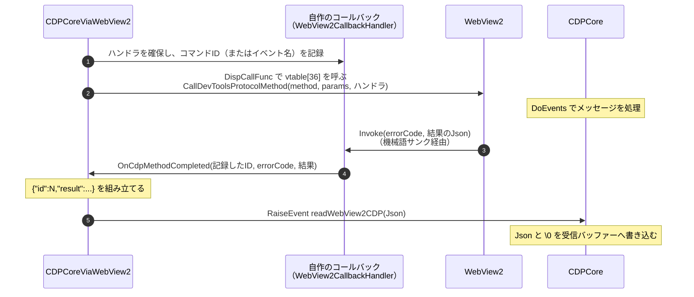
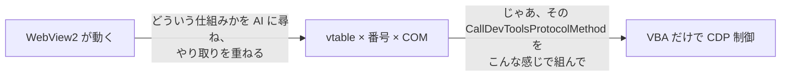

# 技術秘話: WebView2 経路

VBA 界隈では、ある議論がひそかに続いていました。

* Excel VBA で WebView2 を出すには、どうするべきか

その議論に、ついに終止符が打たれました。

先行したのは Access で、[Access には公式のコントロールとして登場](/stories/webview2-story)しました。VBA 界隈では、すでにこれを自動化に応用するショート動画もありました。

では、Excel ならどうなるか…。これまでは、外部依存が必須でした。

私が調べた限りでは、GitHub 上で公開されている中で最も古い、Excel で WebView2 を呼び出す POC は [lucasplumb/ExcelWebView2](https://github.com/lucasplumb/ExcelWebView2) です。いわゆる、参照設定で登録するタイプの制御です。

ただ悲しいことに、調査した時点では 32bit にしか対応していませんでした。うちは 64bit の Excel を入れているので、わざわざ入れ直すのが面倒で、やる気になりませんでした。32bit で入れ直せば、動くところを見られるのかもしれません。でも、世の中はもう 64bit が主流です。Windows 11 も 64bit が前提になりつつある今、32bit で入れ直す手間すら面倒になりました。

時がたち、[たーぼー氏の投稿](https://x.com/fenblen_puyo/status/1908834844949594422)で、この時点での現実解が見つかりました。見ての通り、どのルートに進んでも外部依存が必須です。この時点では、それが答えでした。

ただし、プリインストールのものだけで済ませる縛りなら、多少の実現性はありました。ps1 と VBA の組み合わせです。

超簡潔に言うと、次のようなものです。

* ps1 で起動した WebView2 のフォームを、VBA の `SetParent` で VBA の UserForm へ無理やり引き込み、見た目の上で WebView2 を動かす

でも、[Edge を埋め込む方法](/userform/edge)を見てお気づきの通り、これは Edge を WebView2 に置き換えただけにすぎません。処理の主体は、あくまでも ps1 です。結局、ps1 をメンテしないといけません。

VBA 側のコードとして呼び出せる WebView2 はないのか…。

しばらくは現れませんでした。

しかし、ついに来ました。

[tarboh/WebView2-For-Excel-VBA](https://github.com/tarboh/WebView2-For-Excel-VBA)

これは、AI 時代だからこそ実現できたリポジトリです。

## CDP を受け取るまでの流れ

このツールは、WebView2 の次の3つのメソッドだけで CDP をやり取りします。

| やりたいこと                 | WebView2 のメソッド                                           |
| ---------------------- | -------------------------------------------------------- |
| CDP コマンドを送る            | `ICoreWebView2::CallDevToolsProtocolMethod`              |
| セッションを指定して CDP コマンドを送る | `ICoreWebView2_11::CallDevToolsProtocolMethodForSession` |
| CDP イベントを受け取る          | `ICoreWebView2::GetDevToolsProtocolEventReceiver`        |

どれも結果は非同期で、WebView2 がこちらの用意したコールバックオブジェクトを呼び出す形で返ってきます。

### 1. vtable と番号の計算

参照設定（タイプライブラリ）を使わないので、VBA からは `ICoreWebView2` のメソッドを名前で呼べません。そこで、vtable の番号を自分で数えて呼び出します。

COM のインターフェースポインタが指す先の最初の8バイトには、vtable（関数ポインタの配列）の場所が入っています。n 番目のメソッドのアドレスは「vtable の先頭 + n × 8」です。このツールでは、`oleaut32.dll` の `DispCallFunc` に、インターフェースポインタと「番号 × 8」を渡して呼び出しています（`WebView2Thunks.dcf`）。

番号は、0〜2 が `IUnknown`（`QueryInterface` / `AddRef` / `Release`）で、3 以降はヘッダー（`WebView2.h`）での宣言順です。`ICoreWebView2_11` のように継承で増えたインターフェースは、親のメソッドの続きから数えます。

| インターフェース                                               | 番号 | メソッド                                   |
| ------------------------------------------------------ | -- | -------------------------------------- |
| `ICoreWebView2`                                        | 36 | `CallDevToolsProtocolMethod`           |
| `ICoreWebView2`                                        | 42 | `GetDevToolsProtocolEventReceiver`     |
| `ICoreWebView2_11`                                     | 99 | `CallDevToolsProtocolMethodForSession` |
| `ICoreWebView2DevToolsProtocolEventReceiver`           | 3  | `add_DevToolsProtocolEventReceived`    |
| `ICoreWebView2DevToolsProtocolEventReceivedEventArgs`  | 3  | `get_ParameterObjectAsJson`            |
| `ICoreWebView2DevToolsProtocolEventReceivedEventArgs2` | 4  | `get_SessionId`                        |

番号を1つでも間違えると、まったく別のメソッドを呼んでしまい、Excel ごと落ちます。

### 2. コールバックオブジェクトを自作する

WebView2 は結果を返すとき、こちらが渡した「ハンドラ」の COM オブジェクトの `Invoke` を呼びます。VBA には C++ のオブジェクトを作る手段がないので、COM オブジェクトの形をメモリ上に直接組み立てます（`WebView2Thunks.bas`）。

1. `VirtualAlloc` で、実行可能なメモリ領域（`PAGE_EXECUTE_READWRITE`）を確保する。224 バイトのスロットを 512 個並べた領域です
2. スロットごとに、vtable を指すポインタと、vtable 本体（`QueryInterface` / `AddRef` / `Release` / `Invoke`）を書き込む。最初の3つは、標準モジュールの関数を `AddressOf` で取り出したアドレスです
3. `Invoke` の行き先には、機械語のサンクを書き込む

サンクは、WebView2 からの呼び出しを、VBA のクラスのメソッド（`WebView2CallbackHandler.Handler_Invoke`）の呼び出しに作り替えます。

* 引数を1つずつ右へずらし（`rcx` → `rdx`、`rdx` → `r8`、`r8` → `r9`）、空いた先頭（`rcx`）に VBA のハンドラオブジェクトのアドレスを入れる

* 戻り値を受け取る場所のアドレスを、5番目の引数としてスタックに置く

* `Handler_Invoke` を呼び、受け取った戻り値を WebView2 へ返す

VBA のクラスの `Public` なメソッドは、内部では「先頭にオブジェクト自身、最後に戻り値の受け取り先」を持つ COM のメソッドとして呼ばれます。サンクがやっているのは、この形への詰め替えです。

`Handler_Invoke` のアドレスは、VBA のクラスの vtable の 7 番から取り出します。0〜6 は `IUnknown`（3個）と `IDispatch`（4個）で埋まっていて、最初の `Public` メソッドが 7 番に来るためです。そのため、`WebView2CallbackHandler` の `Public` メンバーは `Handler_Invoke` だけにしてあります。

また、サンクの先頭では、メモリ領域の生存フラグを確かめています。VBE のリセットなどで領域が使えなくなったあとに呼ばれた場合は、何もせずに 0 を返します。

### 3. 引数だけでは足りない情報を、ハンドラに持たせる

WebView2 の公式リファレンスでは、2つのコールバックの引数は次のとおりです。

| コールバック                                                    | `Invoke` の引数                                                  | 足りない情報                  |
| --------------------------------------------------------- | ------------------------------------------------------------- | ----------------------- |
| `ICoreWebView2CallDevToolsProtocolMethodCompletedHandler` | `errorCode`、結果の Json                                          | どのコマンドの結果か（CDP の `id`）  |
| `ICoreWebView2DevToolsProtocolEventReceivedEventHandler`  | `sender`、`args`（`get_ParameterObjectAsJson` で `params` だけ取れる） | どのイベントか（CDP の `method`） |

Pipe や WebSocket では、ブラウザから届く Json に `id` や `method` が入っています。WebView2 では、これらが引数に含まれません。

そこで、ハンドラを確保するときに、足りない情報をハンドラ自身に記録しておきます。

* コマンドを送るとき（`SendCommandCDP`）：コマンド1件ごとにハンドラを1つ確保し、`callbackId` にコマンド ID を記録する

* イベントを購読するとき（`SubscribeCdpEvent`）：イベント名ごとにハンドラを1つ確保し、`EventName` にイベント名を記録する

C++ なら、この記録はラムダ式のキャプチャで済みます。たとえば `[id](HRESULT errorCode, LPCWSTR result) { ... }` と書けば、`id` を持ったオブジェクトをコンパイラーが作ってくれます。VBA にはラムダ式もキャプチャもないため、同じことをハンドラのクラスに値を持たせる形で、手作業で実現しています。

コールバックが来たら、`Handler_Invoke` は記録しておいた値を引数に足して、`CDPCoreViaWebView2` へ渡します（`OnCdpMethodCompleted` / `OnCdpEventReceived`）。そこで、CDP の形の Json に組み立て直します。

| 受け取ったもの           | 組み立てる Json                             |
| ----------------- | -------------------------------------- |
| コマンドの結果（成功）       | `{"id":記録したID,"result":結果}`            |
| コマンドの結果（失敗）       | `{"id":記録したID,"error":エラー内容}`          |
| イベント              | `{"method":記録したイベント名,"params":params}` |
| タブなど、セッション由来のイベント | 上に `"sessionId"` を足したもの                |

セッション ID は、`args` を `QueryInterface` で `ICoreWebView2DevToolsProtocolEventReceivedEventArgs2` に切り替え、`get_SessionId`（4 番）で取り出しています。

### 4. Pipe と同じ形にそろえる

組み立てた Json は、`RaiseEvent readWebView2CDP` で `CDPCore` へ渡します。`CDPCore` は、受け取った Json と終端の目印 `\0` を、Pipe 版と同じ受信バッファーに書き込みます（`viaWebView2_readWebView2CDP`）。

WebView2 のコールバックは、Excel がメッセージを処理するタイミングで届きます。そのため、`CDPCore` の受信処理（`TakeWebView2`）は、`DoEvents` を呼んでバッファーが増えなくなるまで待ちます。

ここから先は、[Pipe 経路](/stories/pipe-tech)や [WebSocket 経路](/stories/websocket-tech)とまったく同じ処理です。WebView2 からは、UTF-16 の文字列として、欠けのない Json が1件ずつ届きます。そのため、WebSocket のようなフレームの組み立てや、UTF-8 からの変換も要りません。

::: warning イベントの購読はイベント名ごと
Pipe や WebSocket では、ドメインを `enable` すれば、そのドメインのイベントがすべて届きます。WebView2 の `GetDevToolsProtocolEventReceiver` は、イベント名ごとに購読する仕組みです。そのため、このツールでも `SubscribeCdpEvent` で、イベント名を1つずつ指定する必要があります。
:::

::: danger VBE での中断に注意
コールバックはすべて機械語のサンクを経由します。ブレークで止まっているだけなら基本的に安全ですが、止まっている間にコールバックが届くと、Excel が落ちることがあります。購読中のイベントがある状態で VBE をリセットするのは、特に危険です。リセットが必要なときは、先に `UnsubscribeAllCdpEvents` で購読をすべて解除してください。
:::

## AI が越えた実現の壁

…さぁ、どうです？ 読んで分かりますか？ 分かりませんよね。

私もなんとか理屈は理解しましたが、やっていることは要するに、次のとおりです。

* 本来なら C++ のコンパイラーと COM 用のライブラリが用意してくれるものを、VBA で手作業で組み立てた

エミュレート…そうですね、WebSocket の自作でも同じようなことをしていました。あれも言ってしまえば、WebSocket のロジックを純 VBA だけでエミュレートしたにすぎません。だから、送受信のロジックだけが、ほかと違う流れや見た目の書き方になりました。でも、あれはまだかわいい方です。

WebView2 も、本質的には同じです。ただし WebView2 の場合は、送受信だけでなく、立ち上げから流れが違います。そして、この流れの部分は本来、C++ ならコンパイラーと COM 用のライブラリ（WRL や ATL など）が自動で用意してくれるものです。それを純 VBA だけで再現したにすぎません。

| このツールでやっていること                            | C++ で同じことを書いた場合                                                                                             |
| ---------------------------------------- | ----------------------------------------------------------------------------------------------------------- |
| vtable の番号を数える（36、42、99 など）              | コンパイラーが `WebView2.h` の宣言から決める。人は `CallDevToolsProtocolMethod(...)` と名前で書くだけ                                 |
| `DispCallFunc` で、x64 の呼び出し規約どおりに引数を並べて呼ぶ | コンパイラーが呼び出しのコードを生成する                                                                                        |
| コールバック用の COM オブジェクトと vtable を、メモリ上に組み立てる | クラスを書けば、コンパイラーが vtable を作る。`QueryInterface` / `AddRef` / `Release` は、WRL の `Callback` などのライブラリが用意する         |
| ハンドラに `callbackId` や `EventName` を記録する   | コンパイラーが、ラムダ式のキャプチャとして作る                                                                                     |
| 機械語のサンクで、先頭に VBA のオブジェクトを差し込んでから呼ぶ       | C++ では、メンバー関数として呼べば `this` が渡るので、このような変換自体が要らない。ただし、ATL のウィンドウ用サンクのように、ライブラリが実行時に機械語を書き込んで `this` を差し込む例もある |

厳密に言えば、コンパイラーそのものを作ったわけではありません。ソースを解析して機械語を生成しているのではなく、コンパイラーやライブラリが生成するはずのものを、決まった形で手作業で置いています。

でもこれ、人間に書けます？ 私はノーです。だから長らく、Excel で WebView2 を呼び出せず、Access で我慢していた時期がありました。

この高い壁を、あっさり越えてしまったのが AI です。AI には、次の2つの軸があると思っています。

1. **ルールが厳格であること**

   * vtable のポインタの並び順、メモリのバイトオフセット、COM の ABI（バイナリインターフェース）

   * 「人間の気まぐれ」が入る余地がない、完全な数学的パズル
2. **ネット上の情報量**

   * VB6 と VBA の先人たちが 1998年から書きためてきた、25年分以上の COM ハックの記録が、ネットの海にぎっしり沈んでいる

意外にも、この VBA × COM ハック系の歴史は深いです。そして、COM や vtable の仕組みそのものは、WebSocket と同じくらい、ルールが厳格に決まっています。それが奇跡的にかみ合って、Excel での WebView2 の呼び出しが現実になりました。

そして、VBA 自体はかなり前から更新が止まっています。つまり…

* 答え自体は、前から Yes だった。ただ、実現の壁が高すぎて、実質 No だった。その壁を AI が越えて、Yes になった

ただそれだけのことでした。

ルールさえ厳格なら、プロンプト次第で、人間には面倒な vtable の構築や番号の計算も、AI はあっさり解いてしまいます。

うれしいようで、怖い存在ですね。昨今は、個人情報の漏えいも相次いでいます。

「なるほど、原理はそういうことか。じゃあ、その原理に基づいてこう組んで」

たったこの1文で、もう攻撃コードが完成していると思うと、なんだかなぁという感じです。結局は、その「原理」にたどり着く工程をどうするか、ということなのかもしれませんが。

まぁ、結局は使う人次第ですね。

## WebView2 にもあった拡張機能の制限

[WebSocket 経路](/stories/websocket-tech)にもあった拡張機能の制限は、WebView2 でも起こりました。
単純に `Extensions.loadUnpacked` を送っても、`Method not available.` エラーになり、機能しません。

### 拡張機能を有効にするオプション

しかたなく、`WebView2EnvOptions.cls` という COM のエミュレートを作ることになりました。
というのも WebView2 では、環境を作るときのオプション（`AreBrowserExtensionsEnabled`）を ON にしないと、拡張機能が使えない仕様なのです。[公式リファレンス](https://learn.microsoft.com/en-us/microsoft-edge/webview2/reference/win32/icorewebview2environmentoptions6)でも、このオプションの既定値は `FALSE` で、そのままでは新しい拡張機能をインストールできないと書かれています。

もっと言えば、初代 WebView2 には、拡張機能という概念がありませんでした。Win32 版の WebView2 が正式リリース（GA）になったのは、2020年10月の [SDK 1.0.622.22](https://learn.microsoft.com/en-us/microsoft-edge/webview2/release-notes/sdk/1-0-622-22) です。拡張機能への対応が正式に入ったのは、2023年12月の [SDK 1.0.2210.55](https://learn.microsoft.com/en-us/microsoft-edge/webview2/release-notes/sdk/1-0-2210-55) からでした。[拡張機能を求める Issue](https://github.com/MicrosoftEdge/WebView2Feedback/issues/98) は、GA より前の2020年1月から立っています。そういったこともあって、オプション経由で切り替える形になったんだろうな～と思っています。

しかもこれがやっかいで、ただ単に拡張機能を ON にするフラグを1つ設定すれば済む、というわけではありません。

- オプション専用のクラスオブジェクト（COM）を作る儀式
- その中の「拡張機能」を有効にする設定
- それを WebView2 に拾わせるサンク

という、（人間にとっては）だるい仕様です。

`ICoreWebView2EnvironmentOptions` は、アプリ側が実装して WebView2 に渡すインターフェースです。C++ なら、SDK の `WebView2EnvironmentOptions.h` に既定の実装が用意されています。VBA にはそれがないので、前述の「2. コールバックオブジェクトを自作する」と同じように、vtable からメモリ上に組み立てることになります。もうこの辺は AI に任せました。

### 理由を教えてくれないエラー

ところが、作ったところでアクシデントです。問答無用でエラー終了、理由は詳しく教えてくれない、という理不尽なことに出くわしました。`CreateCoreWebView2EnvironmentWithOptions` が `hr=&H80070057`（`E_INVALIDARG`）を返して、即座に失敗するのです。
しかも、AI に訊いてもあまりいい回答を得られない時期がありました。

もう無理かとあきらめかけたその時、ヒントがあったのが Rust で開発中の WebView2 でした。[webview2-rs の Issue](https://github.com/wravery/webview2-rs/issues/10) に載っていたコードは、オプションを `CoreWebView2EnvironmentOptions::default()` で作っていました。この `default()` を[ソース](https://github.com/wravery/webview2-rs/blob/main/crates/webview2-com/src/options.rs)でたどると、`TargetCompatibleBrowserVersion` に SDK のバージョン（`CORE_WEBVIEW_TARGET_PRODUCT_VERSION`）を入れていたのです。

Issue 自体は、言語の設定が反映されないという別の相談で、このエラーの答えが直接書いてあったわけではありません。間接的に、結果的に分かった形です。

VBA にも同じ戦法を適用したら、ついに通ってくれました。

[公式リファレンス](https://learn.microsoft.com/en-us/microsoft-edge/webview2/reference/win32/icorewebview2environmentoptions)でも、この値の既定は「アプリが使っている SDK に対応する WebView2 Runtime のバージョン」です。このツールでは、空のまま渡すのをやめ、SDK に合わせた `152.0.4181.0` を既定にしています（`WebView2EnvOptions.cls` の `Class_Initialize`）。

まさか、[Windows のカーネルにも使われ始めた](https://blogs.windows.com/windows-insider/2023/07/12/announcing-windows-11-insider-preview-build-25905/)言語に助けられるとは思いませんでした。

### それでも `Method not available.`

さて、ようやくこれで、拡張機能の `Extensions.loadUnpacked` が使え…ませんでした。また `Method not available.` エラーです。

念のため、`AdditionalBrowserArguments` に例の `--remote-debugging-port=9222` を付けて試すと、こちらから送った `Extensions.loadUnpacked` は通りました。

ただ、CDP に精通しているわいは、なんとな～く理由が分かった気がします。
`Method not available.` エラーは、実は `/page` 単位で同じコマンドを送っても、同じエラーで返ってくるのです。

つまり、次のような違いではないかと考えています。

- `CallDevToolsProtocolMethod`（`ForSession`）：内部では常にページ単位
- `--remote-debugging-port=9222`：ブラウザ単位で接続しているので成功

※あくまでも推測です。

WebView2 の中身までは確かめられませんが、この推測と合う材料は見つかりました。

- Chromium の `chrome/browser/devtools/protocol/extensions_handler.cc` は、拡張機能の読み込みが許されていない接続から `loadUnpacked` が来ると、この `Method not available.` を返します。読み込みを許すかどうかは、`chrome_devtools_session.cc` で、接続先がブラウザ全体（`kTypeBrowser`）かどうかで決まります
- WebView2 の[公式リファレンス](https://learn.microsoft.com/en-us/microsoft-edge/webview2/reference/win32/icorewebview2_11)では、`CallDevToolsProtocolMethodForSession` の `sessionId` を空にすると、トップページの既定のターゲットとして扱うと書かれています。`SessionID` を空にしても効果がなかったのは、このためだと考えられます
- `--remote-debugging-port` で通ったのも、[WebSocket 経路](/stories/websocket-tech)で書いた Chromium 149 の変更で、Pipe 経路の要件が外れたことと合います

### WebView2 向けの拡張機能 API

ということで、そうなると手段は1つです。
WebView2 向けの拡張機能 API（`ICoreWebView2Profile7` の `AddBrowserExtension` / `GetBrowserExtensions` と、`ICoreWebView2BrowserExtension` の `Remove`）を付け足すことです。

コードはかなり増えてしまいましたが、なんとか実現に至りました。
vtable の構築などはもう完全に AI 任せですが、フローはなんとか自分で整理したつもりです。

いっそのこと、`Extensions.loadUnpacked` が来たら、WebView2 の拡張機能 API にリダイレクトするような仕組みも頭をよぎりました。

> いや、いつか CDP としての `Extensions.loadUnpacked` もできるかもしれない

というわずかな望みも捨てきれず、まだリダイレクトの流れは考えていません。デモ（`Demo_WebView2.bas` の `UseExtensionsViaWebView2API`）にも、CDP で試す分岐を残しています。

まぁでも、言ったところで、

> え、なんでわざわざ面倒な `CallDevToolsProtocolMethod` でやるの？ WebView2 用の API があるじゃん

という返信が来そうで、結局一生来ないオチかもしれませんが。

そんな、WebView2 の拡張機能の愚痴でした。

## 参考資料

* [lucasplumb/ExcelWebView2](https://github.com/lucasplumb/ExcelWebView2)（参照設定で使う POC。32bit 版 Office 2016 で作成）

* [tarboh/WebView2-For-Excel-VBA](https://github.com/tarboh/WebView2-For-Excel-VBA)（機械語サンク・vtable 呼び出しの移植元）

* [ICoreWebView2CallDevToolsProtocolMethodCompletedHandler](https://learn.microsoft.com/en-us/microsoft-edge/webview2/reference/win32/icorewebview2calldevtoolsprotocolmethodcompletedhandler)（`Invoke(HRESULT errorCode, LPCWSTR result)`）

* [ICoreWebView2DevToolsProtocolEventReceivedEventArgs](https://learn.microsoft.com/en-us/microsoft-edge/webview2/reference/win32/icorewebview2devtoolsprotocoleventreceivedeventargs)（`get_ParameterObjectAsJson` のみ）

* [DispCallFunc](https://learn.microsoft.com/ja-jp/windows/win32/api/oleauto/nf-oleauto-dispcallfunc)

* [ICoreWebView2EnvironmentOptions6](https://learn.microsoft.com/en-us/microsoft-edge/webview2/reference/win32/icorewebview2environmentoptions6)（`AreBrowserExtensionsEnabled`。既定は `FALSE`）

* [ICoreWebView2Profile7](https://learn.microsoft.com/en-us/microsoft-edge/webview2/reference/win32/icorewebview2profile7)（`AddBrowserExtension` / `GetBrowserExtensions`）

* [ICoreWebView2EnvironmentOptions](https://learn.microsoft.com/en-us/microsoft-edge/webview2/reference/win32/icorewebview2environmentoptions)（`TargetCompatibleBrowserVersion` の既定値）

* [Release notes for the WebView2 SDK 1.0.2210.55](https://learn.microsoft.com/en-us/microsoft-edge/webview2/release-notes/sdk/1-0-2210-55)（2023年12月、拡張機能への対応が正式リリース）

* [chrome/browser/devtools/protocol/extensions_handler.cc](https://source.chromium.org/chromium/chromium/src/+/main:chrome/browser/devtools/protocol/extensions_handler.cc)（`Method not available.` を返す箇所）

* [wravery/webview2-rs#10](https://github.com/wravery/webview2-rs/issues/10)（`CoreWebView2EnvironmentOptions::default()` でオプションを作っているコード）

* [wravery/webview2-rs の options.rs](https://github.com/wravery/webview2-rs/blob/main/crates/webview2-com/src/options.rs)（Rust 向けの `ICoreWebView2EnvironmentOptions` の実装。`default()` で `TargetCompatibleBrowserVersion` に SDK のバージョンを入れる）
